# Smart Retail Floor Allocation

Nền tảng nghiên cứu tối ưu bố trí không gian bán lẻ, phân bổ ngành hàng, xếp SKU
và đánh giá vận hành bằng mô phỏng. Ứng dụng dùng **React/TypeScript, FastAPI và
MongoDB với PyMongo đồng bộ**, triển khai theo kiến trúc **Modular Monolith**.

Tài liệu đối chiếu mã nguồn tại checkout ngày **23/10/2026**. Kết quả audit ngày
22/10/2026 là **SYSTEM_VERIFIED_WITH_LIMITATIONS**: 178 pytest ở mỗi đường dẫn
dài/ngắn, 4 Vitest, 10 Playwright và 24 cổng nghiệm thu trong phạm vi xác định.
Đây là **kết quả lịch sử**, không phải một lần chạy mới khi biên tập README.
Xem [báo cáo và giới hạn](docs/system-audit/FINAL_SYSTEM_AUDIT.md),
[ma trận nghiệm thu](docs/system-audit/END_TO_END_ACCEPTANCE.md) và
[HANDOFF](HANDOFF.md) để phân biệt kiểm chứng mới với bằng chứng trước đó.

## Mục lục

1. [Giới thiệu tổng quan](#phan-01)
2. [Tổng quan chức năng](#phan-02)
3. [Kiến trúc tổng thể](#phan-03)
4. [Thành phần và cấu trúc thư mục](#phan-04)
5. [Công nghệ sử dụng](#phan-05)
6. [Mô hình dữ liệu đầu vào](#phan-06)
7. [Thiết kế MongoDB](#phan-07)
8. [T1 — Bố trí mặt bằng](#phan-08)
9. [T2 — Phân bổ ngành hàng](#phan-09)
10. [T3 — Bố trí sản phẩm](#phan-10)
11. [T4 — Mô phỏng và định tuyến](#phan-11)
12. [Tối ưu liên tầng](#phan-12)
13. [Quy trình thực thi toàn hệ thống](#phan-13)
14. [Worker và xử lý lỗi](#phan-14)
15. [Giao diện và thao tác sử dụng](#phan-15)
16. [Thực nghiệm nghiên cứu E01–E15](#phan-16)
17. [Cài đặt và khởi động Windows](#phan-17)
18. [Triển khai Docker Compose](#phan-18)
19. [Tham chiếu API](#phan-19)
20. [Kiểm thử và đảm bảo chất lượng](#phan-20)
21. [Tái lập nghiên cứu](#phan-21)
22. [Giới hạn và hướng phát triển](#phan-22)
23. [Tài liệu nội bộ](#phan-23)

<a id="phan-01"></a>

## I. Giới thiệu tổng quan

Một mặt bằng thuận tiện về hình học chưa chắc giảm được quãng đường lấy hàng.
Đưa ngành hàng có nhu cầu cao gần cửa cũng chưa chắc giảm thời gian hoàn thành
nếu kệ đó trở thành điểm chờ. Bố trí SKU để tăng tồn trưng bày còn phụ thuộc
kích thước, mặt kệ, chiều cao và tải trọng. Vì vậy dự án nghiên cứu chuỗi quyết
định **T1: vị trí kệ → T2: ngành hàng → T3: SKU → T4: vận hành** trong cùng mô hình.

Đối tượng nghiên cứu là mặt bằng đa giác, kệ chữ nhật xoay 0/90 độ, ngành hàng
không chia nhỏ, khối SKU và các hành trình khách/picker tổng hợp. Mục đích là
tạo phương án khả thi có thể kiểm tra lại, so sánh phương pháp trên cùng đầu
vào và nghiên cứu tác động của phản hồi vận hành đến quyết định thiết kế.
Thao tác bố trí thủ công thường khó kiểm tra đồng thời mọi giới hạn vật lý và
khó tái lập quyết định; dự án cung cấp validation, snapshot và dấu vết đánh giá.

Đóng góp đã triển khai gồm hợp đồng bảy nhóm dữ liệu; engine và bộ kiểm tra độc
lập; hàng đợi bền vững; cache theo phụ thuộc; feedback giảm nghiêm ngặt mục tiêu;
liệt kê miền hữu hạn kèm certificate; campaign, báo cáo và replay có checksum.
Các đóng góp này phục vụ đồ án, luận văn và thực nghiệm thuật toán trong phạm
vi mô hình. Chúng chưa xác lập hiệu quả tại cửa hàng thực hoặc tối ưu hình học
liên tục tổng quát. Dữ liệu sinh tự động được gắn `SYNTHETIC`.

Giả định chính: đơn vị SI; kích thước và nhu cầu do người dùng khai báo;
khách đến theo quá trình Poisson; tốc độ đi lại cố định; tắc nghẽn được biểu diễn
bằng hàng đợi phục vụ tại kệ; không mô phỏng đầy đủ chuyển động đám đông.

<a id="phan-02"></a>

## II. Tổng quan chức năng

Trong bảng dưới, “có” nghĩa là có đường thực thi trong source. Giới hạn đi kèm
là một phần của chức năng, không phải cam kết nghiệm thu sản phẩm thương mại.

| Nhóm | Mục đích và module | Đầu vào → đầu ra | Trạng thái |
|---|---|---|---|
| Dự án | `application/projects.py` | Tên → aggregate và revision | Có tạo/đọc; chưa có xóa |
| Mặt bằng | `contracts/inputs.py`, `FloorplanEditor.tsx` | Đa giác, vùng, cửa → floorplan | Có editor và validation |
| Kệ | `features/shelves`, contracts | Kích thước, tầng, mặt → shelves | Có; kệ chữ nhật |
| Ngành hàng | `features/categories`, T2 | Nhu cầu, quan hệ → assignment | Có; mỗi ngành một kệ |
| Sản phẩm | `features/products`, T3 | SKU và vật lý → planogram | Có; mô hình khối/strip |
| Nhu cầu, đơn hàng | `features/demand`, `features/orders` | Giỏ, thời gian, SKU → demand/orders | Có; mô phỏng tổng hợp |
| Cấu hình | `features/optimization`, contracts | Seed, thuật toán, budget → config | Có giới hạn tài nguyên |
| T1–T4 | `engines/`, `stage_workflow.py` | Dataset → nghiệm và KPI | Có baseline và kiểm tra độc lập |
| Feedback | `application/feedback/` | KPI → đề xuất → incumbent | Có tìm kiếm bị chặn ngân sách |
| Exact | `engines/joint_exact/` | Miền hữu hạn → nghiệm, bounds, proof | Có chứng nhận có điều kiện |
| Hybrid | `feedback/coordinator.py` | Feedback + miền → tìm kiếm hữu hạn | Có; chia sẻ ngân sách |
| Lần chạy | `workers/`, repositories | Snapshot → trạng thái/result | Có hủy, timeout, replay |
| Trực quan | `features/results/` | Nghiệm → bản vẽ, planogram, KPI | Có; không phải digital twin thực |
| Campaign | `application/experiments/` | Manifest → records/checkpoint | Có; một worker/campaign |
| Báo cáo | `reporting/`, experiment reports | Run/records → JSON, CSV, hình | Có; chưa xuất PDF nghiệp vụ |
| Replay | experiment CLI, run API | Snapshot/manifest → kết quả mới | Có; từ chối source drift |
| Persistence | `infrastructure/mongodb/` | Aggregate/payload → MongoDB/GridFS | Có CAS, lease, fencing |

<a id="phan-03"></a>

## III. Kiến trúc tổng thể

Modular Monolith giữ một backend theo module nghiệp vụ, đồng thời tách process
web và process tính toán. Presentation Layer là React; API Layer là HTTP adapters;
Application Layer chọn quy trình; Domain Layer chứa dữ liệu SI bất biến;
Optimization Engine Layer giải từng mô hình. Infrastructure triển khai repository,
cache và provenance; Persistence là MongoDB/GridFS. Background Worker giám sát
process con; Reporting and Research Layer tạo campaign, so sánh và báo cáo.

### Quy ước đọc sơ đồ

Các sơ đồ được đọc **từ trên xuống**. Khi gặp hình thoi, chọn nhánh theo nhãn
trên mũi tên; đường quay lại một khối phía trên biểu thị vòng lặp hoặc phản hồi.
Vị trí trái/phải giúp tách nhánh, không thể hiện mức ưu tiên hay thời gian chạy.

| Ký hiệu | Cách hiểu |
|---|---|
| Hình chữ nhật | Một thành phần, bước xử lý, dữ liệu hoặc trạng thái; đọc nhãn trong khối để phân biệt |
| Hình thoi | Câu hỏi hoặc điều kiện; đi tiếp theo nhánh `Có`/`Không` hay nhãn tương ứng |
| Hình trụ | Nơi lưu bền vững như MongoDB hoặc Docker volume |
| Mũi tên liền có hướng | Chiều xử lý, dữ liệu hoặc lời gọi; nhãn trên đường nối cho biết ý nghĩa cụ thể |
| Mũi tên nét đứt có hướng | Quan hệ bổ trợ như hiện thực hợp đồng, giám sát hoặc quay lại luồng; đọc chú thích của từng sơ đồ |
| Đường nối không mũi tên | Quan hệ gắn kết/chia sẻ, ví dụ container sử dụng volume; không biểu thị thứ tự xử lý |

Trong sơ đồ dữ liệu, hình thoi **đặc ở đầu đường nối** mang nghĩa chứa thành phần,
khác với hình thoi lớn dùng làm nút điều kiện trong flowchart. Màu mặc định của
Mermaid chỉ để trình bày, không dùng để kết luận thành công, lỗi hoặc mức bảo đảm.

| Thuật ngữ trên sơ đồ | Giải thích ngắn |
|---|---|
| UI / API / HTTP | Giao diện người dùng / giao diện lập trình / giao thức trao đổi yêu cầu và phản hồi |
| T1 / T2 / T3 / T4 | Bố trí kệ / phân bổ ngành hàng / xếp SKU / mô phỏng vận hành |
| SKU / KPI | Mã sản phẩm / chỉ số đánh giá kết quả |
| CAS / revision | Chỉ cập nhật khi phiên bản đang lưu khớp phiên bản người gửi mong đợi |
| Snapshot / SHA-256 | Bản chụp đầu vào bất biến / mã kiểm tra tính toàn vẹn của dữ liệu |
| Worker / child process | Tiến trình nhận và giám sát công việc / tiến trình con thực hiện tính toán |
| Lease / fencing | Quyền xử lý có thời hạn / kiểm tra để chủ sở hữu cũ không ghi kết quả |
| Incumbent / UB / LB | Nghiệm tốt nhất đã giữ / cận trên / cận dưới của mục tiêu đang giảm |
| Replay / seed | Chạy lại theo điều kiện đã ghi / giá trị khởi tạo bộ sinh ngẫu nhiên |

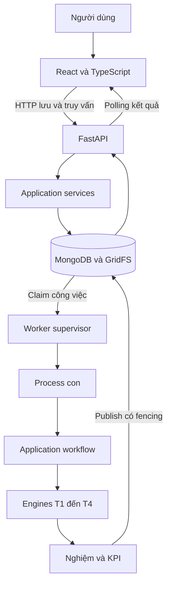

**Chú thích sơ đồ 1 — Ai gửi yêu cầu, ai tính toán, ai lưu kết quả?**

- Nhánh từ React đến FastAPI và application services là đường người dùng lưu,
  đọc dữ liệu hoặc gửi yêu cầu chạy. `Claim công việc` là worker nhận một job đã lưu.
- Process con thực hiện T1–T4; `Publish có fencing` chỉ cho ghi kết quả nếu worker
  còn quyền sở hữu. MongoDB/GridFS là nơi lưu, không phải khối giải thuật.
- Đường quay về React qua API cho biết giao diện lấy kết quả bằng polling:
  hỏi lại định kỳ, thay vì giữ một HTTP request chờ tính toán xong.

HTTP lưu/đọc dữ liệu và enqueue; numerical workflow chạy trong process con.
Mũi tên database–worker biểu thị hàng đợi bền vững, không phải một message broker
riêng. React đọc trạng thái qua API; API không gọi solver dài trong request.

<a id="phan-04"></a>

## IV. Thành phần và cấu trúc thư mục

```text
backend/
  pyproject.toml, requirements-lock.txt, Dockerfile
  src/smart_retail/
    api/                         HTTP adapters
    application/
      projects.py, workflow.py, stage_workflow.py, decisions.py
      feedback/                  điều phối và đánh giá joint
      experiments/               generator, campaign, CLI, thống kê
    contracts/                   Pydantic, tabular, schema, finite space
    domain/                      dataclass bất biến theo nghiệp vụ
    engines/
      t1_layout/, t2_allocation/, t3_slotting/, t4_simulation/
      joint_exact/, navigation.py
    infrastructure/
      mongodb/, repositories/, provenance.py, stage_cache.py, filesystem.py
    workers/                     runner.py, resources.py
    reporting/                   export.py
  tests/                         contracts, unit, integration, regression, performance
frontend/
  src/
    app/                         shell, navigation, state hooks
    components/                  input editor, badge, stat
    features/                    input definitions, editor, research, result viewers
    pages/                       workspace pages và báo cáo
    services/                    HTTP client
    types/, utils/
  tests/                         Vitest và Playwright
datasets/                        samples, joint fixtures, schemas, manifests
experiments/                     configs, CLI wrappers, results, reports, visualization
scripts/                         setup, lifecycle, checks, deployment verifiers
configs/                         cấu hình mẫu
docs/                            kiến trúc, dữ liệu, nghiên cứu, vận hành, audit
docker-compose.yml
AGENTS.md, HANDOFF.md, README.md
```

Cây lược bỏ dependency đã cài, cache, binary và hàng nghìn artifact sinh ra.
Khi khảo sát có 1.664 tệp Git quản lý và không có tệp nguồn mới chưa theo dõi;
con số này là kiểm kê đầu công việc, không phải kích thước checkout sau dọn tài liệu.

| Module backend | Trách nhiệm, tệp quan trọng | Phụ thuộc và vị trí trong luồng |
|---|---|---|
| `api` | `main.py`, `research.py`: HTTP, validation errors, export | Gọi application, repository wiring |
| `application` | `projects.py`: aggregate; `workflow.py`: dispatch | Contracts, domain, engines, repository contracts |
| `application/feedback` | `coordinator`, `evaluator`, `neighborhood`, `bootstrap` | Giữ incumbent, gọi official stages và exact callback |
| `application/experiments` | `campaign`, `generators`, `analysis`, `service`, `cli` | Dùng production queue và worker thật |
| `contracts` | `inputs`, `feedback`, `optimality`, `experiments`, `tabular` | Pydantic → domain; JSON schemas |
| `domain` | Các dataclass `frozen` theo nhóm nghiệp vụ | Không biết HTTP/database |
| `engines` | Solver, geometry, routing, independent validators | Chỉ numerical/domain; không chọn toàn workflow |
| `infrastructure` | MongoDB, filesystem, runtime identity, StageCache | Hiện thực persistence và artifact storage |
| `workers` | `runner.py`, `resources.py` | Claim, spawn, giám sát, publish |
| `reporting` | `export.py` | Run → JSON/planogram CSV |

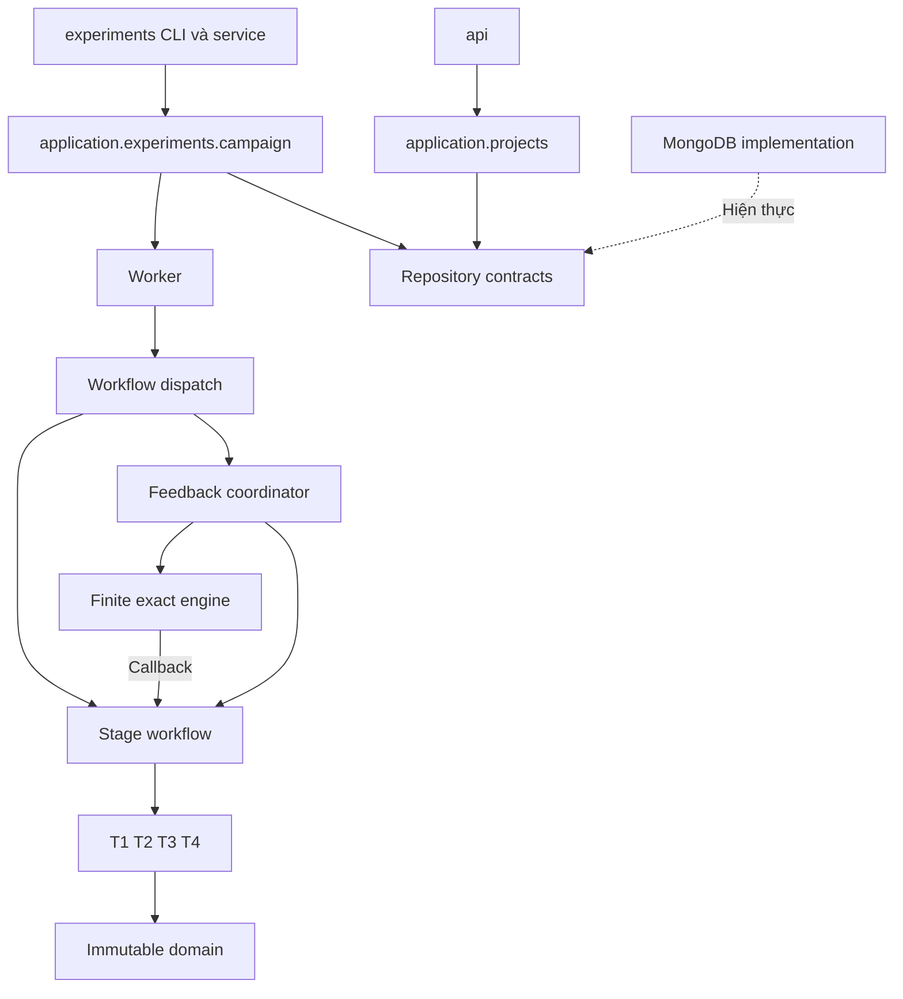

**Chú thích sơ đồ 2 — Các module backend phối hợp như thế nào?**

- Mỗi khối là một module hoặc nhóm trách nhiệm. Mũi tên biểu thị lời gọi hoặc
  phụ thuộc chính, không phải thứ tự triển khai các tệp nguồn.
- Đường nét đứt `Hiện thực` cho biết MongoDB cung cấp phần triển khai của hợp
  đồng repository. `Callback` là hàm đánh giá do application truyền cho exact engine.
- `Workflow dispatch` chọn cách chạy; `Stage workflow` gọi các tầng T1–T4.
  Domain ở cuối sơ đồ là mô hình dữ liệu dùng chung, không phải bước tính toán cuối.

Exact không import application: chiều callback do application truyền vào duy
trì ranh giới numerical engine. Kiểm tra import tại `scripts/verify_architecture.py`.

<a id="phan-05"></a>

## V. Công nghệ sử dụng

Phiên bản dưới đây lấy từ lock/package/Dockerfile; không phải dự đoán phiên bản
mới nhất. Python yêu cầu `>=3.12`; Dockerfile backend chọn `python:3.12-slim`.
Node frontend yêu cầu `>=22.12.0`; image build là `node:22-alpine`.

| Công nghệ | Phiên bản cấu hình | Vai trò thực tế |
|---|---|---|
| Python | `>=3.12` | Backend, numerical engines, worker |
| FastAPI / Pydantic | `0.157.0` / `2.14.1` | HTTP, hợp đồng và JSON Schema |
| React / TypeScript / Vite | `19.3.1` / `6.0.3` / `8.3.5` | Giao diện có kiểu, build và dev proxy |
| Konva / React Konva | `10.9.0` / `19.3.2` | Canvas mặt bằng theo tọa độ thực |
| MongoDB | Compose `mongo:8.0`; helper Windows `8.0.16` | Document, queue, single-document atomics |
| PyMongo / GridFS | `4.18.2`; GridFS đi kèm driver | Persistence đồng bộ và scientific JSON lớn |
| NumPy / SciPy | `2.5.4` / `1.18.1` | Ma trận và `scipy.optimize.milp` |
| HiGHS | Đọc trực tiếp bởi `runtime_identity()` | Solver MILP đi kèm SciPy, phiên bản nằm trong run |
| Shapely / NetworkX | `2.2.0` / `3.7` | Hình học, connectivity và shortest paths |
| SimPy / Matplotlib | `4.1.2` / `3.11.2` | Discrete-event simulation và hình báo cáo |
| Pytest / Hypothesis | `9.1.1` / `6.170.5` | Regression, integration và property tests |
| Ruff / mypy | `0.17.1` / `1.20.2` | Lint và kiểm tra kiểu Python |
| Vitest / Playwright | `5.0.5` / `1.64.1` | Unit frontend và tương tác trình duyệt |
| Docker / Compose | Không khóa phiên bản CLI trong source | Stack có volume, health và initialization |

Image tags không phải immutable digest. Khi cần tái lập môi trường, giữ lock,
runtime identity và image identity của deployment thực sự đã dùng.

<a id="phan-06"></a>

## VI. Mô hình dữ liệu đầu vào

Nguồn chuẩn: [contracts/inputs.py](backend/src/smart_retail/contracts/inputs.py),
[schema fixtures](datasets/schemas) và [mẫu đầy đủ](datasets/samples/small_store.json).
Mỗi section có `schema_version: "1.1"` và `data_origin`. Pydantic cấm trường lạ,
NaN/Infinity; tham chiếu được kiểm tra trước khi lưu và trước enqueue.

| Nhóm | Trường quan trọng và đơn vị | Ràng buộc, quan hệ |
|---|---|---|
| `floorplan` | `boundary`, `entrance`, `exits`, `pickup_points`, `obstacles`, `zones`, `grid_m`, `min_aisle_m` — m | Đa giác đơn, diện tích ≤10.000 m²; grid 0,1–2 m; điểm/vùng hợp lệ |
| `shelves` | `layout_mode`, `items`, `x/y`, `rotation`, `faces`, `levels` — m/kg | ≤100 kệ; mặt 1/2; xoay 0/90; tầng không vượt kệ; locked cần tọa độ |
| `categories` | `id`, `priority`, `demand`, `required_width_m`, `fixed_shelf_id`, `near`, `separate`, `affinity` | ID duy nhất; width >0; không tự tham chiếu/mâu thuẫn proximity |
| `products` | `sku`, `category_id`, kích thước m, `weight_kg`, `facings`, `stack_layers`, `clearance_m` | SKU duy nhất, category tồn tại; min/max facings và shelf kind tương thích |
| `demand` | `arrivals_per_hour`, `horizon_s`, `customers`, `baskets`, `behavior`, `periods`, `picker_count`, `routing_policy` | Horizon ≤86.400 s; periods có thứ tự, không giao nhau; SKU hợp lệ |
| `orders` | `orders`, `order_lines`, `placed_at`, `due_s`, `quantity` | Timestamp có múi giờ; quantity nguyên dương; mỗi đơn có line; khóa kép không trùng |
| `optimization` | `seed`, `time_limit_s`, thuật toán, trọng số, `joint`, `memory_limit_mb` | Budget ≤300 s; 128–8.192 MiB; ít nhất một trọng số tích hợp dương |

Các ví dụ sau là từng section hợp lệ và dùng chung ID. Bỏ các trường tùy chọn
sẽ dùng mặc định của hợp đồng; đây là dữ liệu tổng hợp tối thiểu để đọc cấu trúc.

### Mặt bằng

```json
{"schema_version":"1.1","data_origin":"SYNTHETIC","units":"m","boundary":[[0,0],[8,0],[8,8],[0,8]],"entrance":[0,4],"obstacles":[],"min_aisle_m":0.5,"grid_m":0.5,"exits":[[8,4]],"pickup_points":[],"zones":[],"require_connected_aisles":true}
```

### Kệ và tầng kệ

```json
{"schema_version":"1.1","data_origin":"SYNTHETIC","layout_mode":"fixed","items":[{"id":"S1","width_m":2,"depth_m":0.6,"height_m":1.5,"x":2,"y":3,"rotation":0,"faces":2,"locked":false,"levels":[{"id":"L1","width_m":1.9,"depth_m":0.5,"height_m":0.5,"max_load_kg":80}]}]}
```

### Ngành hàng

```json
{"schema_version":"1.1","data_origin":"SYNTHETIC","items":[{"id":"A","name":"Ngành tổng hợp","priority":1,"demand":10,"required_width_m":0.3,"fixed_shelf_id":"S1","near":[],"separate":[],"distance_m":3,"affinity":{}}]}
```

### SKU

```json
{"schema_version":"1.1","data_origin":"SYNTHETIC","items":[{"sku":"P1","name":"Sản phẩm tổng hợp","category_id":"A","width_m":0.1,"depth_m":0.1,"height_m":0.2,"weight_kg":0.2,"demand":10,"facings":1,"orientations":[0,90],"stack_layers":1,"clearance_m":0.01,"min_facings":1,"max_facings":2,"allowed_shelf_kinds":["gondola"]}]}
```

### Nhu cầu và hành vi

```json
{"schema_version":"1.1","data_origin":"SYNTHETIC","arrivals_per_hour":20,"horizon_s":600,"customers":5,"baskets":[["P1"]],"behavior":{"model":"synthetic_basket","speed_m_s":1.2,"dwell_s":2},"periods":[],"picker_count":1,"routing_policy":"nearest"}
```

### Đơn hàng

```json
{"schema_version":"1.1","data_origin":"SYNTHETIC","orders":[{"id":"O1","placed_at":"2026-10-23T08:00:00+07:00","kind":"online","due_s":120}],"order_lines":[{"order_id":"O1","sku":"P1","quantity":2}]}
```

### Cấu hình tối ưu

```json
{"schema_version":"1.1","data_origin":"SYNTHETIC","seed":42,"time_limit_s":30,"max_iterations":10000,"algorithm":"milp","slotting_algorithm":"first_fit","layout_algorithm":"grid","candidate_count":1,"travel_weight":1,"wait_weight":0,"stock_weight":0,"stop_after_stage":"T4","memory_limit_mb":2048,"joint":null}
```

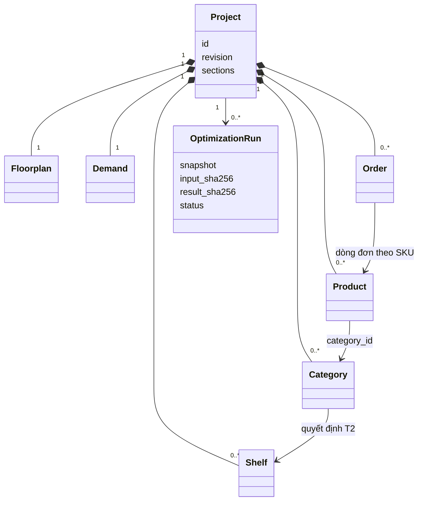

**Chú thích sơ đồ 3 — Phân biệt dữ liệu chứa trong project và quan hệ tham chiếu.**

- `Project`, `Shelf`, `Product` và các hộp khác là kiểu dữ liệu logic. Các dòng
  trong hộp Project/OptimizationRun là những thuộc tính tiêu biểu của kiểu đó.
- Hình thoi đặc ở phía Project nghĩa là dữ liệu thành phần thuộc aggregate này.
  `1` nghĩa là một; `0..*` nghĩa là không có hoặc có nhiều phần tử. Project đang
  nhập dở có thể chưa đủ các nhóm; chạy tối ưu mới yêu cầu đầu vào đầy đủ.
- Các mũi tên `category_id`, `dòng đơn theo SKU`, `quyết định T2` lần lượt là
  tham chiếu sản phẩm–ngành, đơn–sản phẩm và quan hệ phân bổ ngành–kệ.
  Một project có thể có nhiều run, mỗi run giữ snapshot riêng.

Đây là quan hệ logic. Bảy nhóm được nhúng trong `projects.sections`; không có
collection riêng cho từng Shelf/Category/Product. Run giữ snapshot của revision
tại thời điểm enqueue, độc lập với các lần sửa project về sau.

<a id="phan-07"></a>

## VII. Thiết kế cơ sở dữ liệu MongoDB

| Collection | Nội dung | Cơ chế chính |
|---|---|---|
| `projects` | ID, tên, revision, created_at, bảy sections | CAS theo `_id` + `revision`; aggregate tối đa 8 MiB |
| `optimization_runs` | Project ID/revision, snapshot, result, SHA, status, owner/lease | Atomic claim, renew, fenced publish |
| `worker_heartbeats` | Worker ID, epoch, status | Online nếu heartbeat mới trong 10 giây |
| `research_payloads.files` | Metadata GridFS | ID, bytes, SHA-256 |
| `research_payloads.chunks` | Các chunk JSON | Lưu payload quá lớn hoặc không biểu diễn BSON trực tiếp |

Một deployment đã có dữ liệu có thể còn metadata vận hành không do workflow mới
tạo ra. Bảng mô tả các collection chính được code ứng dụng hiện hành sử dụng;
không giả định đây là toàn bộ collection trong mọi database đã từng tồn tại.

CAS dùng `find_one_and_update({_id, revision}, {$set: sections, $inc: revision})`.
Hai người cùng lưu revision cũ chỉ một người thắng; request còn lại nhận HTTP
409 và phải tải lại trước khi quyết định lưu tiếp. Không ghi đè âm thầm.

Snapshot/result dưới 4 MiB và biểu diễn BSON được giữ inline. Payload vượt ngưỡng
hoặc có số nguyên vượt BSON int64 được mã hóa canonical JSON vào GridFS.
Blob hoàn tất trước khi document cha nhận reference; đọc lại kiểm tra byte count
và SHA-256. Không cắt ngắn dữ liệu. Publish/CAS thất bại có thể để lại blob chưa
được tham chiếu; chưa có cơ chế tự thu gom các blob này.

Indexes: project theo `created_at`; run theo project/time, status/time,
worker/lease và status/lease; heartbeat theo epoch; `_id` có unique index mặc định.
Không đặt TTL xóa tự động dữ liệu nghiên cứu. Writes dùng `w="majority"` và journal;
không dựa vào transaction nhiều document.

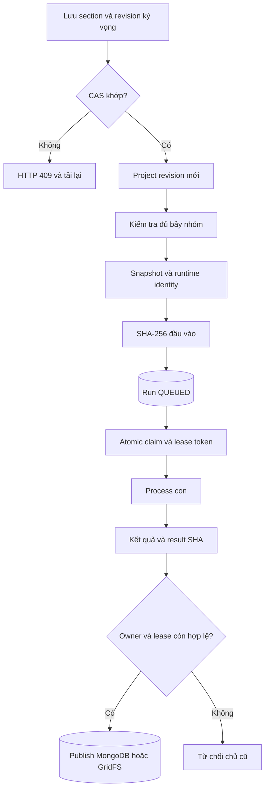

**Chú thích sơ đồ 4 — Từ một lần lưu dữ liệu đến một kết quả bền vững.**

- `CAS khớp?` so revision trong yêu cầu với revision ở database. Nhánh không
  khớp trả HTTP 409: dữ liệu đã thay đổi, người dùng cần tải lại.
- Khi đầu vào đủ và hợp lệ, hệ thống tạo snapshot, ghi SHA-256 rồi đưa run vào
  `QUEUED` — đang chờ. Claim chuyển quyền xử lý cho một worker có lease token.
- Điều kiện cuối kiểm tra quyền công bố kết quả. Nhánh từ chối bảo vệ database
  khỏi kết quả do worker đã mất lease gửi về, kể cả khi child đã tính xong.

Vòng đời dữ liệu tách cập nhật project khỏi snapshot run. Xem
[vận hành](docs/migration/MONGODB_OPERATIONS.md) và
[BSON/GridFS backup](docs/migration/MONGODB_BACKUP_RESTORE.md).
Backup của công cụ dự án cần mọi writer dừng và không phải snapshot online xuyên
collection; filesystem artifacts phải sao lưu riêng. Restore chỉ vào database mới.

<a id="phan-08"></a>

## VIII. T1 — Floor Layout Optimization

Nguồn: [engine](backend/src/smart_retail/engines/t1_layout/engine.py),
[geometry](backend/src/smart_retail/engines/t1_layout/geometry.py),
[search](backend/src/smart_retail/engines/t1_layout/search.py).
Biến quyết định là $(x_s,y_s,\theta_s)$ của kệ, $\theta_s\in\{0,90\}$.
Footprint dùng tọa độ góc hộp bao; rotation 90 hoán đổi chiều rộng và sâu.
Kệ locked giữ nguyên pose. `fixed` chỉ kiểm tra bố trí đã khai báo.

Grid xây dựng nghiệm theo thứ tự diện tích giảm dần, duyệt điểm lưới và hai
hướng xoay; các variant đổi thứ tự kệ, chiều quét và ưu tiên xoay. Local Search
thử dịch một bước lưới hoặc xoay một kệ, chọn cải thiện tốt nhất có kiểm tra.

Mục tiêu local search đúng theo code là tổng khoảng cách Euclid từ cửa vào đến
tâm footprint, không phải tổng quãng đường T4:

$$
J_1=\sum_{s\in S}\|c_s-e\|_2\quad\text{(m)}.
$$

Ràng buộc: footprint nằm trong boundary; không giao kệ/vật cản/vùng cấm;
khoảng cách đến kệ khác, biên, vật cản và cửa đạt `min_aisle_m` theo tolerance.
Kiểm tra cuối còn xét exit/pickup, required aisle, service faces và connectivity
trên lưới. Topology rời rạc phụ thuộc `grid_m`.

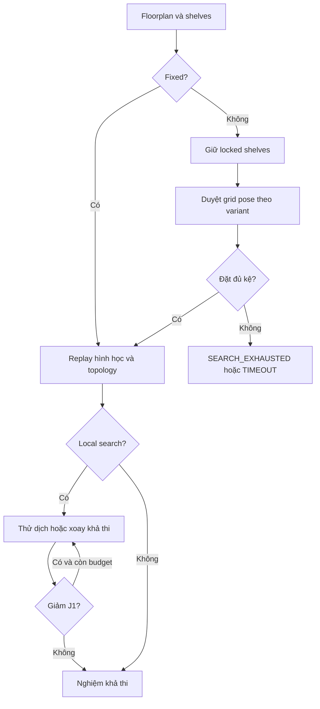

**Chú thích sơ đồ 5 — T1 tạo và kiểm tra vị trí kệ.**

- `Fixed?` hỏi có dùng nguyên bố trí đã nhập hay không. Nếu có, hệ thống chỉ
  kiểm tra; nếu không, nó giữ các kệ locked và thử vị trí trên lưới cho phần còn lại.
- `Replay hình học và topology` kiểm tra lại kích thước, khoảng cách và khả
  năng tiếp cận. `Giảm J1?` hỏi tổng khoảng cách từ cửa vào đến tâm kệ có giảm không.
- Đường quay lại bước thử dịch/xoay là local search. Kết quả là một bố trí khả
  thi; nhánh search hết ngân sách không có nghĩa mọi bố trí đều vô nghiệm.

Grid dừng khi đủ kệ, hết candidate budget, deadline hoặc bị hủy. Local search
dừng khi không cải thiện hoặc hết ngân sách. `SEARCH_EXHAUSTED` không chứng minh
vô nghiệm. `VALID_FIXED`, `FEASIBLE_GRID_BASELINE`, `FEASIBLE_LOCAL_SEARCH` không
phải chứng nhận tối ưu toàn cục.

<a id="phan-09"></a>

## IX. T2 — Category Allocation

Nguồn: [engine](backend/src/smart_retail/engines/t2_allocation/engine.py) và
[replay](backend/src/smart_retail/engines/t2_allocation/validation.py).
Với ngành $c$ và kệ $s$, $x_{cs}\in\{0,1\}$. Mỗi ngành chọn đúng một kệ;
nhiều ngành có thể chung một kệ. Sức chứa T2 là tổng usable width các tầng nhân
số mặt, chưa thay thế kiểm tra vật lý SKU tại T3.

$$
\sum_s x_{cs}=1,\qquad
\sum_c r_c x_{cs}\le f_s\sum_{\ell\in L_s}W_{s\ell}.
$$

`fixed_shelf_id` khóa lựa chọn. Near/separate xét khoảng cách Euclid giữa tâm kệ:
các cặp lựa chọn vi phạm ngưỡng bị cấm bằng $x_{cs}+x_{dt}\le1$.
Gọi $D$ là đường chéo lớn nhất của boundary, $a_c=demand_c\,priority_c$,
$b_{cd}$ là affinity có hướng đã khai báo. Hàm mục tiêu là:

$$
J_2=w_d\sum_{c,s}\frac{a_c}{\sum a\ \mathrm{or}\ 1}
\frac{\|e-c_s\|_2}{D}x_{cs}
+w_a\sum_{c,d,s,t}\frac{b_{cd}}{\sum b\ \mathrm{or}\ 1}
\frac{\|c_s-c_t\|_2}{D}y_{csdt}.
$$

$y=x_{cs}x_{dt}$ được tuyến tính hóa bởi $y\le x_{cs}$, $y\le x_{dt}$,
$y\ge x_{cs}+x_{dt}-1$. Mục tiêu không có đơn vị; affinity hai chiều nếu khai báo
cả hai sẽ được tính theo cả hai mục tương ứng.

| Phương pháp | Cách chọn | Bảo đảm và giới hạn |
|---|---|---|
| MILP | SciPy/HiGHS, binary model, gap mục tiêu bằng 0 | `OPTIMAL` trong mô hình T2; incumbent hợp lệ có thể là `FEASIBLE_TIME_LIMIT` |
| Greedy | Ưu tiên nhu cầu × priority; thử kệ theo chi phí và khả thi | `FEASIBLE_GREEDY`; thất bại là `SEARCH_EXHAUSTED` |

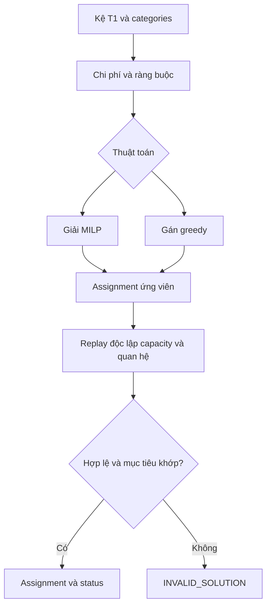

**Chú thích sơ đồ 6 — T2 chọn kệ cho từng ngành hàng.**

- MILP là giải mô hình quy hoạch tuyến tính nguyên hỗn hợp; Greedy là gán lần
  lượt theo quy tắc ưu tiên. Hai nhánh là hai lựa chọn, không phải hai bước bắt buộc nối tiếp.
- `Assignment ứng viên` là ánh xạ ngành hàng → kệ. Replay độc lập kiểm tra lại
  sức chứa, quan hệ gần/tách và ràng buộc kệ cố định mà không dựa vào ma trận solver.
- `Mục tiêu khớp?` so chi phí tính lại với chi phí đã báo; sai khác hoặc vi phạm
  ràng buộc dẫn đến `INVALID_SOLUTION`, không được nhận làm nghiệm.

Giới hạn: tối đa 20.000 biến gồm affinity auxiliaries; tối đa 200.000 proximity
constraints. HiGHS có thể chứng minh vô nghiệm T2; điều đó chưa phải chứng minh
vô nghiệm mọi bố trí joint khi T1 có thể thay đổi.

<a id="phan-10"></a>

## X. T3 — Product Slotting

Nguồn: [first-fit](backend/src/smart_retail/engines/t3_slotting/engine.py),
[MILP](backend/src/smart_retail/engines/t3_slotting/mip.py),
[physical replay](backend/src/smart_retail/engines/t3_slotting/validation.py).
Mỗi SKU là một khối trên đúng kệ của ngành hàng, một mặt và một tầng; không có
trộn SKU trong cùng lane sâu hay đan xen dọc phức tạp.

| Đại lượng | Ý nghĩa và tính toán |
|---|---|
| `face` / `level_id` | Mặt kệ đánh số từ 0 và tầng đã khai báo |
| `orientation` | 0/90; đổi chiều rộng $w$ và chiều sâu $d$ |
| `facings` $f$ | Số đơn vị ngang; first-fit dùng giá trị khai báo, MILP xét min/max |
| `layers` $l$ | Số lớp đứng; không vượt stack limit và chiều cao tầng |
| `depth_units` $q$ | Số đơn vị theo chiều sâu |
| `x_m` / `width_m` | Vị trí trái và bề rộng khối trên strip |
| `capacity_units` | $f l q$, đơn vị sản phẩm |
| `load_kg` | `capacity_units × weight_kg`, kg |

Với clearance $g$, first-fit dùng:

$$
B=f(w+g),\quad
l=\min\!\left(stack\_layers,\left\lfloor\frac{H+10^{-9}}{h+g}\right\rfloor\right),\quad
q=\left\lfloor\frac{D+10^{-9}}{d+g}\right\rfloor.
$$

Phải có $l,q\ge1$, tổng block width trên cùng mặt/tầng không vượt usable width,
không overlap và tổng load **qua mọi mặt cùng tầng** không vượt `max_load_kg`.
First-fit xếp SKU theo demand giảm dần và chọn vị trí đầu tiên vừa; nó dùng số
lớp/sâu tối đa ở lựa chọn đó nên có thể thất bại dù một lựa chọn khác khả thi.

Từ bản sửa ngày 27/10/2026, khi first-fit thất bại, T3 thử sắp lại toàn bộ SKU
trên đúng kệ bị kẹt bằng tìm kiếm xác định có quay lui, tối đa 20.000 trạng thái
và 64 SKU/kệ, đồng thời tuân thủ deadline và yêu cầu hủy. Giữ nguyên assignment,
facings và chính sách lấy số lớp/sâu tối đa; không nới kích thước/tải trọng và
không gọi MILP. Nghiệm qua kiểm tra độc lập được ghi `FEASIBLE_FIRST_FIT_REPAIRED`;
các ca first-fit thành công ngay vẫn là `FEASIBLE_FIRST_FIT`. Hết ngân sách tìm
kiếm vẫn là thất bại heuristic, không chứng minh vô nghiệm. Đây là thay đổi
baseline: bằng chứng chạy lại cần danh tính mã nguồn riêng, không thay kết quả
trong báo cáo paper-v3 cũ.

MILP liệt kê các option hữu hạn theo shelf/face/level/orientation/facings/layers/
depth. Biến nhị phân $z_{po}$ chọn đúng một option/SKU, với tổng width mỗi strip
và tổng tải mỗi tầng bị chặn. Code minimize chi phí âm, tương đương:

$$
\max J_3=\sum_{p,o} demand_p\,capacity_{po}\,z_{po}.
$$

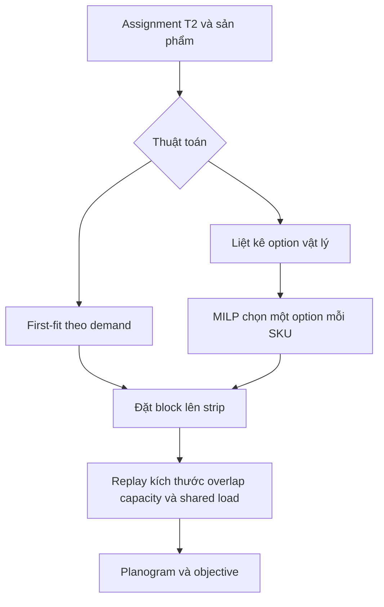

**Chú thích sơ đồ 7 — T3 chuyển phân bổ ngành thành vị trí SKU cụ thể.**

- Đầu vào đã biết mỗi ngành thuộc kệ nào. First-fit chọn chỗ vừa đầu tiên;
  MILP chọn giữa các option vật lý được liệt kê, như mặt/tầng/hướng đặt.
- `Strip` là dải chiều rộng hữu dụng trên một mặt và một tầng kệ. `Block` là
  khối chiếm chỗ của một SKU; `shared load` là tải cộng dồn qua các mặt cùng tầng.
- Replay tính lại kích thước, overlap, capacity và tải trước khi trả planogram,
  tức sơ đồ bố trí sản phẩm. Capacity là sức chứa mô hình, không phải tồn kho thực tế.

MILP giới hạn 20.000 options; deadline áp dụng cả sinh option và giải.
`SLOTTING_FAILED` của first-fit không phải vô nghiệm đã chứng minh. `OPTIMAL`
chỉ thuộc mô hình strip hữu hạn. Capacity là sức chứa tĩnh, không phải lượng
hàng tồn thực tế hoặc cam kết đáp ứng mọi đơn; T4 chưa trừ tồn khi picking.

<a id="phan-11"></a>

## XI. T4 — Simulation & Routing

Nguồn: [navigation](backend/src/smart_retail/engines/navigation.py),
[simulation](backend/src/smart_retail/engines/t4_simulation/engine.py),
[routing](backend/src/smart_retail/engines/t4_simulation/routing.py).
Mạng di chuyển dùng tâm ô lưới, cạnh bốn hướng dài `grid_m`, loại điểm/cạnh
xuyên vật cản hoặc kệ. Connector nối entrance/exit với graph; service point
phải tiếp cận mặt dài của kệ. Giới hạn 40.000 ô.

`nearest` chọn service point gần nhất còn lại; `return` sắp theo ID và quay về
start sau mỗi điểm; `exact` dùng dynamic programming cho tour đóng tối đa 10
service locations. Độ phức tạp tour exact tăng theo $O(n^2 2^n)$; đây là tối ưu
tour đóng trên graph, chưa tối ưu open tour đa cửa ra.

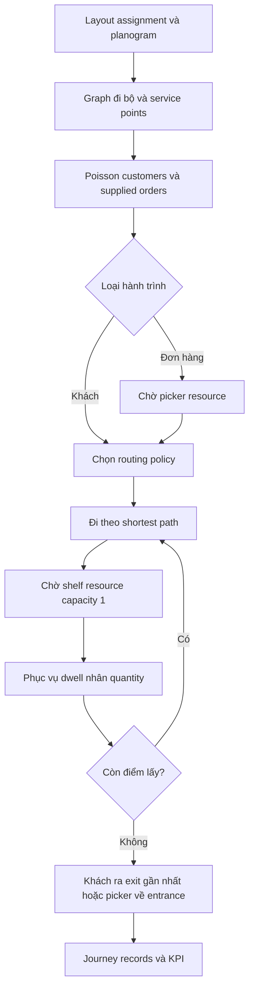

**Chú thích sơ đồ 8 — T4 mô phỏng một hành trình lấy hàng.**

- `Graph đi bộ` là mạng các ô có thể đi qua; `service point` là điểm tiếp cận
  mặt kệ. Đường ngắn nhất được tính trên mạng này, không đi xuyên kệ hay vật cản.
- Khách tự mua và đơn được picker lấy hàng đi vào hai nhánh khác nhau. Đơn hàng
  có thể phải chờ người lấy hàng rảnh; cả hai loại hành trình có thể phải chờ phục vụ tại kệ.
- Vòng `Còn điểm lấy?` lặp cho đến khi lấy xong giỏ/đơn. KPI tổng hợp từ các
  hành trình đã hoàn tất; hàng đợi kệ không biểu diễn đầy đủ đám đông ngoài thực tế.

Customers không dùng picker pool; supplied orders dùng pool hữu hạn. Cả hai cạnh
tranh resource phục vụ kệ. Hai mặt một kệ dùng chung resource. Tốc độ đi cố định;
thời gian phục vụ bằng `dwell_s × quantity`. Orders đến theo số giây từ timestamp
đơn sớm nhất. Periods ghi đè arrival rate chung; khoảng trống không có arrivals.
Ngừng nhận arrivals tại horizon nhưng các hành trình đã nhận chạy đến hoàn tất.

| KPI trong `T4.metrics` | Cách tính | Đơn vị và ý nghĩa |
|---|---|---|
| `completed` | Số journeys hoàn tất, gồm khách và picker | Hành trình |
| `mean_distance_m` | Tổng distance / max(1, số journeys) | m; hiệu quả tuyến trung bình |
| `mean_wait_s` | Tổng picker pool wait + shelf wait / số journeys | s; thời gian chờ tổng hợp |
| `mean_completion_s` | Trung bình completion − arrival | s; gồm di chuyển, chờ, picking |
| `late_orders` | Đếm picker có elapsed > `due_s` | Đơn; due tính theo elapsed từ arrival |
| `total_distance_m` | Tổng chiều dài tuyến, kể cả connectors | m |
| `total_travel_s` | Tổng distance / speed | s |
| `total_picking_s` | Tổng quantity × dwell | s |
| `max_shelf_queue` | Lớn nhất độ dài queue được quan sát khi request | Lượt chờ; không phải mật độ người |
| `picker_utilization` | Busy từ lúc nhận picker đến hoàn tất / (end × picker_count) | Tỷ lệ; gồm cả shelf wait |
| `throughput_per_hour` | completed × 3600 / simulation_end_s | Hành trình/giờ; gồm cả customers |

Đây là hàng đợi tại kệ và mô hình tuyến rời rạc, không phải mô phỏng động lực
học đám đông trong hành lang. Shortest path dùng NetworkX; SimPy điều phối thời
gian và resources. Replay kiểm tra tuyến, khoảng cách, hạch toán thời gian và
quantity bằng implementation kiểm tra riêng ở application experiments.

<a id="phan-12"></a>

## XII. Tối ưu liên tầng T1–T4

### Chế độ và hàm mục tiêu

| Chế độ | Cơ chế tìm kiếm | Phạm vi chứng minh và giới hạn |
|---|---|---|
| Sequential | Một pipeline T1→T2→T3→T4 | Nghiệm từng tầng không suy ra joint optimal |
| Multistart | Nhiều variant, đánh giá đủ chuỗi, chọn tốt nhất; ở joint mode, variant ≥ 1 là random walk hợp lệ hình học trên vị trí kệ (seed = `seed`, variant), T2/T3 tối ưu lại | Chỉ các candidates đã thử; tối đa `candidate_count` |
| Random search | Restart ngẫu nhiên có seed trên vị trí kệ tới hết `max_evaluations` | Baseline cùng ngân sách đánh giá; không chứng minh tối ưu |
| Annealing | Cùng neighborhood với feedback, chọn bước ngẫu nhiên đều, nhận bước xấu theo Metropolis | Baseline cùng ngân sách; tách giá trị chẩn đoán T4 khỏi việc tìm kiếm thêm |
| Feedback | KPI T4 sinh sửa quyết định, strict descent | Có thể hội tụ cục bộ trong neighborhood đã xét |
| Exact | Cartesian enumeration miền tường minh | Chứng minh finite/SAA nếu đủ lá và verifier PASS |
| Hybrid | Feedback rồi exact, warm start nếu thuộc miền | Cùng giới hạn miền; cùng time/evaluation budget |

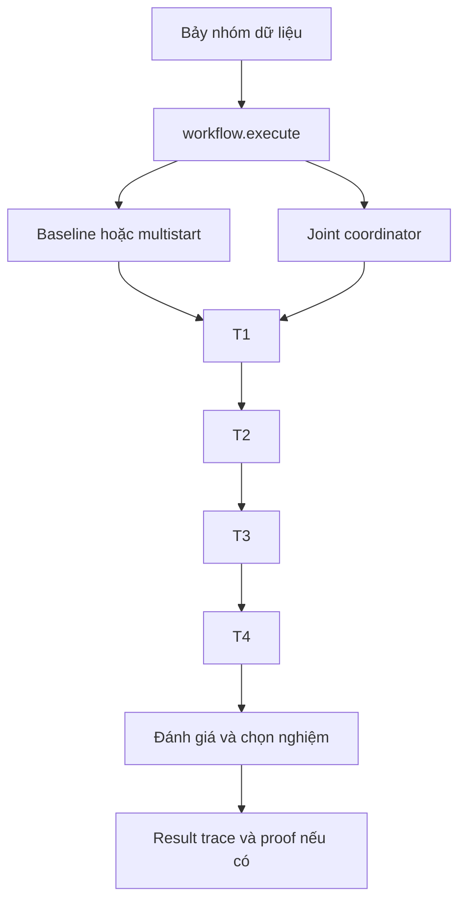

**Chú thích sơ đồ 9 — Chọn cách điều phối chung cho T1–T4.**

- `workflow.execute` là điểm vào chọn chế độ. Nhánh baseline/multistart và
  nhánh joint coordinator là hai cách điều phối, đều dùng chuỗi engine chính thức.
- Mỗi tầng sử dụng quyết định phía trước: vị trí kệ → ngành hàng → SKU → KPI
  vận hành. Khối đánh giá so các phương án theo objective của chế độ đã chọn.
- `Proof nếu có` chỉ xuất hiện khi chế độ và điều kiện chứng minh đáp ứng;
  một result thành công không tự đồng nghĩa tối ưu toàn cục.

Hai đường objective khác nhau được triển khai, không hoán đổi kết quả giữa chúng:

| Đường thực thi | Thành phần được giảm | Chuẩn hóa |
|---|---|---|
| `workflow.py`, không có `joint` | Mean distance, mean wait, stock shortfall | Đường chéo mặt bằng, horizon, tổng demand |
| `feedback/evaluator.py`, có `joint` | Distance, wait, shortfall, tỷ lệ late orders | `objective.scales` cố định do cấu hình |

Baseline: $J=(w_t\bar d/D+w_q\bar q/H+w_b b)/(w_t+w_q+w_b)$,
$b=\sum_p\max(0,demand_p-capacity_p)/\max(1,\sum_p demand_p)$.
`stop_after_stage` có thể dừng T1/T2/T3 với score riêng: $J_1$, $J_2$, $-J_3$.
Joint bắt buộc đủ T4. Với seed scenarios $K$:

$$
F(x)=\frac1{|K|}\sum_{k\in K}
\left(\frac{\bar d_k}{a_1},\frac{\bar q_k}{a_2},\frac{b_k}{a_3},\frac{u_k}{a_4}\right),
\qquad J(x)=\frac{\sum_i w_iF_i(x)}{\sum_iw_i}.
$$

$u$ dùng số đơn late chia max(1, tổng supplied orders); weights không âm,
scales dương và cố định. Joint dùng common random numbers: mọi ứng viên cùng
training seeds. `job_seed_offsets` cộng offset với job seed modulo $2^{31}$.
Holdout seeds rời training và không dùng cho acceptance/ranking/certificate.
Quan sát số thực serialized được so sánh bằng `Fraction`; điều này không biến
SimPy/hình học thành số học thực chính xác vô hạn.

### Closed-Loop Feedback

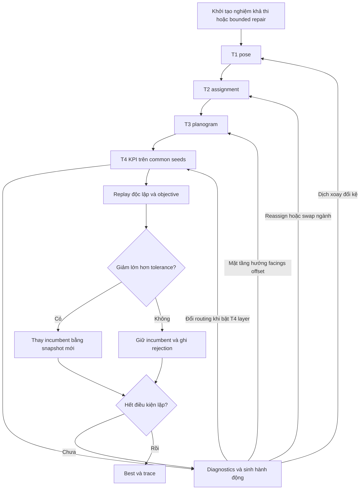

**Chú thích sơ đồ 10 — Đọc vòng phản hồi từ kết quả vận hành về thiết kế.**

- Theo đường T1 → T2 → T3 → T4 để xem một phương án được đánh giá. Các mũi tên
  từ Diagnostics quay về T1/T2/T3 là đề xuất sửa quyết định dựa trên KPI vừa quan sát.
- Nhánh quay về T4 chỉ đổi routing khi bật layer này. `Common seeds` giúp các
  phương án được so trên cùng kịch bản ngẫu nhiên; `incumbent` là nghiệm tốt nhất đang giữ.
- Chỉ thay incumbent sau replay hợp lệ và cải thiện lớn hơn tolerance. Nhánh
  không cải thiện giữ nguyên nghiệm cũ, ghi lý do rồi kiểm tra điều kiện dừng.

Diagnostics dùng SKU picks, shelf visits, tuyến, wait và cặp ngành cùng giỏ.
Chia tổng travel/wait của journey cho các SKU/điểm ghé là proxy chẩn đoán, không
phải đo trực tiếp thời gian tại mỗi vị trí. Actions được round-robin qua layers
đang bật, cắt theo `max_actions`; mặc định layers là T1/T2/T3, chưa bật T4.
Khởi tạo có bounded repair assignment khi sequential slotting thất bại.
Mọi sửa đổi là bản sao; validation trước khi thay incumbent.

Chấp nhận khi $J(new)<J(best)-tolerance$; có first/best improvement. Dừng theo
iterations, evaluations, actions, patience, target, deadline, hủy hoặc memory
supervisor. `CONVERGED_LOCAL` chỉ nói về neighborhood thực sự đã xét. Archive
Pareto chỉ gồm các candidates được đánh giá, không phải toàn bộ frontier.

| Quyết định đổi | Phần cần tính lại về mặt phụ thuộc |
|---|---|
| T1 pose | T1 và T2/T3/T4 phía sau |
| T2 assignment | Giữ T1; kiểm tra T2, chạy lại T3/T4 |
| T3 placement | Giữ T1/T2; kiểm tra T3, chạy lại T4 |
| Routing policy | Giữ T1/T2/T3; chạy lại T4 |

Cache content-addressed còn ràng buộc runtime, objective/scenario context và
budget. Quyết định tường minh trùng nghiệm đã cache có thể tái dùng artifact đã
kiểm tra; không chỉ dựa vào tên stage. Cache hỏng bị từ chối, không bỏ qua lỗi.

### Exact Joint và Hybrid

Miền là tích Cartesian của các lựa chọn pose/kệ, assignment/ngành,
placement/SKU và routing policies. Không tự mở rộng miền ngoài cấu hình.
Số trạng thái là tích kích thước các domain; `max_states` chặn miền quá lớn.
Từng điểm phải qua official validators và independent replay.

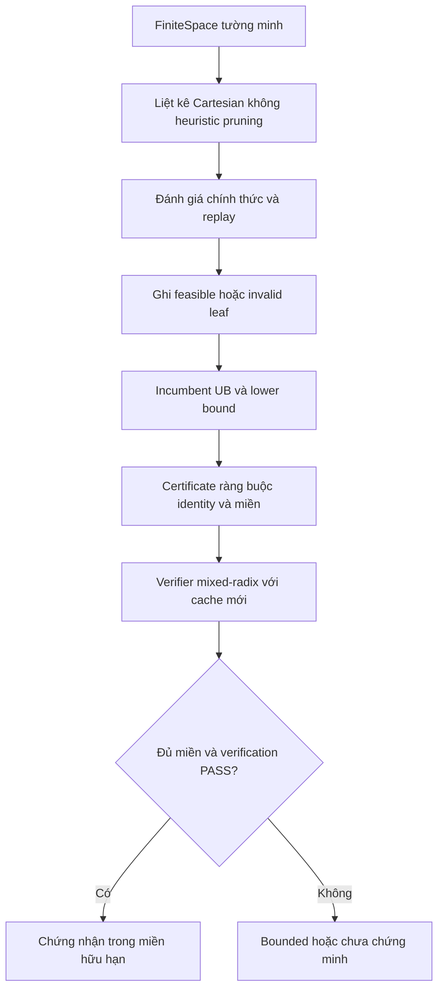

**Chú thích sơ đồ 11 — Khi nào Exact có thể đưa ra chứng nhận?**

- `FiniteSpace` là danh sách lựa chọn hữu hạn được khai báo. `Cartesian` nghĩa
  là xét các tổ hợp của những lựa chọn đó; mỗi `leaf` là một tổ hợp đã kiểm tra.
- UB/LB là cận trên/dưới cho mục tiêu đang giảm. Certificate ghi miền, identity,
  các lá và bounds; verifier tính lại để kiểm tra chứ không chỉ đọc trạng thái solver.
- Nhánh chứng nhận yêu cầu đủ miền và verification PASS. Nếu hết thời gian hoặc
  chưa kiểm đủ, chỉ giữ kết luận có giới hạn; chứng nhận không mở rộng ra ngoài miền này.

UB là score của nghiệm hợp lệ thuộc miền; LB=0 hợp lệ do mọi thành phần không
âm. Nếu duyệt hết miền và có nghiệm thì LB=UB. Absolute gap=UB−LB, relative
gap chia max($10^{-15}$, |UB|). Duyệt hết không có nghiệm có thể cho
`INFEASIBLE_PROVEN` trong miền đó; hết thời gian/evaluation không được gắn nhãn này.
Certificate chứa identity, finite-space hash, mọi lá, witness hash, bounds và
completeness. SHA là seal phát hiện thay đổi, không phải chữ ký số hay proof tự đủ.

Verifier không gọi search-selection solver: giải mã mixed-radix riêng, tính lại
mọi lá, kiểm tra incumbent và objective. Nó vẫn dùng official physics/simulator,
không phải implementation vật lý hoàn toàn độc lập. Product chỉ đặt
`global_optimality_proven=true` khi certificate `GLOBAL_OPTIMAL_CERTIFIED`
**và** verifier `PASS`. Phạm vi là miền hữu hạn và fixed sample-average objective;
luôn giữ `JOINT_GENERAL_OPTIMALITY_NOT_PROVEN` cho bài toán tổng quát.

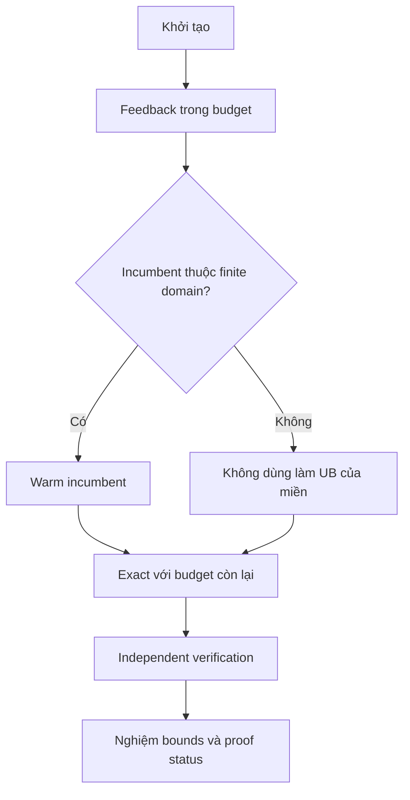

**Chú thích sơ đồ 12 — Hybrid kết hợp tìm nhanh và kiểm chứng hữu hạn.**

- Feedback tìm một nghiệm tốt trước. Câu hỏi ở hình thoi kiểm tra nghiệm này
  có thật sự nằm trong miền Exact đã khai báo hay không.
- `Warm incumbent` là nghiệm sẵn có để Exact giữ làm cận trên ban đầu. Nếu
  nghiệm nằm ngoài miền, không được dùng nó làm UB cho miền đó.
- Exact và verifier sử dụng ngân sách còn lại. Vì vậy Hybrid có thể trả nghiệm
  và bounds mà chưa đạt chứng nhận đầy đủ nếu thời gian kiểm chứng không đủ.

Hybrid không biến nghiệm heuristic ngoài miền thành cận trên của miền. Search
và verifier dùng chung wall budget; hoàn tất search nhưng chưa verifier xong
không được coi là chứng nhận hoàn chỉnh. Xem
[mô hình joint](docs/research/JOINT_OPTIMIZATION_FORMULATION.md).

<a id="phan-13"></a>

## XIII. Quy trình thực thi end-to-end

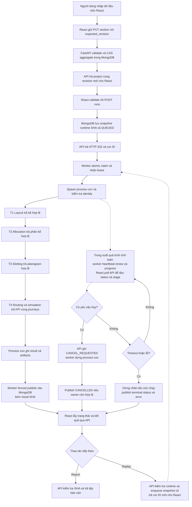

**Chú thích sơ đồ 13 — Theo dõi một yêu cầu từ màn hình đến báo cáo.**

- Đọc trục chính từ người dùng xuống các bước lưu, tạo snapshot, nhận job và
  tính T1–T4. HTTP 202 chỉ xác nhận đã nhận job vào hàng đợi, chưa phải tính xong.
- Nhánh nét đứt giám sát hoạt động trong lúc process con chạy. Heartbeat báo
  worker còn sống; renew gia hạn lease; polling cho React cập nhật status/stage.
- Hoàn tất, hủy và lỗi đều dẫn về chỗ giao diện đọc trạng thái. Nhánh Replay
  quay lại claim cho một run mới từ snapshot cũ, không ghi đè kết quả gốc.

`projects.save_section/enqueue` thực hiện validation/snapshot;
`mongodb/*_repository.py` thực hiện CAS và queue;
`workers/runner.py` spawn/giám sát; `stage_workflow.py` gọi engine và ghi stages;
`api/main.py` cung cấp report/replay. Replay tạo run mới và không thay snapshot
của run gốc. Workflow joint có thể lặp đánh giá T1–T4 theo phần XII.

<a id="phan-14"></a>

## XIV. Worker và xử lý lỗi

Worker CLI heartbeat, recover expired leases rồi claim job QUEUED cũ nhất.
Claim gắn worker ID và lease token ngẫu nhiên; lease 30 giây được renew khi
supervisor còn làm việc. Process con được tạo bằng multiprocessing `spawn`.
Child so runtime identity trước execute; supervisor kiểm tra input SHA trước spawn.

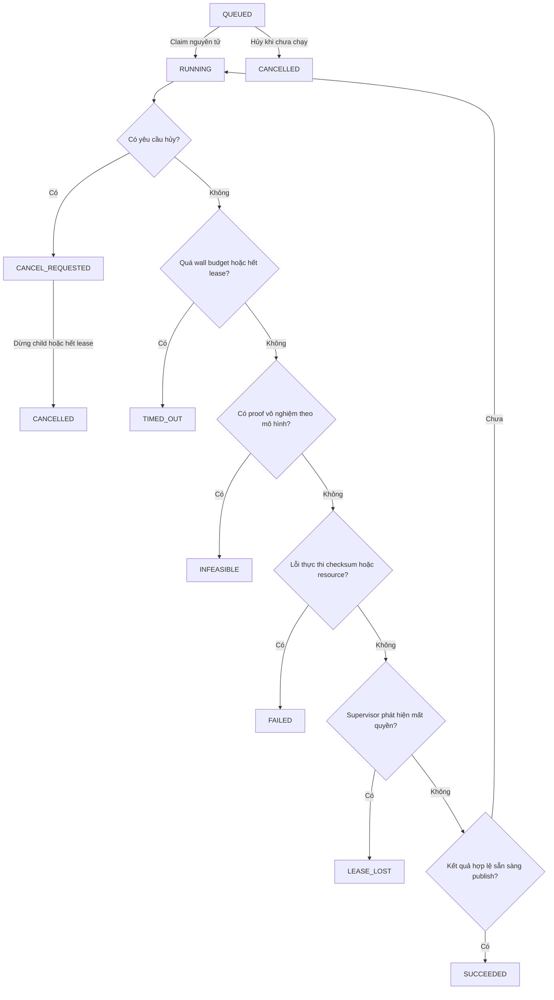

**Chú thích sơ đồ 14 — Phân biệt đang chờ, đang chạy và kết thúc.**

- `QUEUED` là chờ nhận; `RUNNING` là đã claim. Có hai hộp cùng nhãn `CANCELLED`
  để tách hủy khi còn chờ và hủy sau khi chạy; chúng là cùng một giá trị trạng thái.
- Các hình thoi giải thích những tình huống dẫn đến trạng thái tiếp theo. Vòng
  `Chưa` quay về RUNNING nghĩa là chưa có kết quả cuối, tiếp tục giám sát.
- `INFEASIBLE` cần chứng minh theo mô hình; `FAILED` là lỗi; `TIMED_OUT` là hết
  thời gian/lease. `LEASE_LOST` còn chịu fencing nên owner cũ có thể không ghi được nhãn này.

Sơ đồ nhóm các nhánh trạng thái theo chiều dọc để dễ đọc, không biểu thị thứ tự
kiểm tra điều kiện trong từng vòng giám sát. Các trạng thái đều được
runner/repository xử lý. Fencing có thể từ chối
publish của owner cũ; khi đó trạng thái đọc lại từ database là kết quả cuối.
`LEASE_LOST` là nhánh supervisor có thể đặt; không bảo đảm nó được ghi nếu lease
đã hết. `RESOURCE_LIMIT`, `SOURCE_DRIFT`, `INPUT_CORRUPT`, `WORKER_LOST` là error
codes, không tự thêm thành job state. Stage và joint trace status là miền riêng.

| Kiểm soát | Hành vi thực tế |
|---|---|
| Hard wall | `time_limit_s + 2` giây startup grace; tính cả spawn latency |
| Memory | Sample RSS process con; vượt budget → FAILED/RESOURCE_LIMIT |
| Hủy | QUEUED hủy nguyên tử; RUNNING chuyển yêu cầu rồi terminate/kill child |
| Crash | Hết lease RUNNING → TIMED_OUT/WORKER_LOST; yêu cầu hủy → CANCELLED |
| Publication | So worker ID/token, active status và lease chưa hết |
| Cancel race | Cancellation đến cuối vẫn thắng khi publish nguyên tử |
| Telemetry | CPU/RSS lấy từ OS; khoảng lấy mẫu có thể bỏ lỡ đỉnh ngắn |
| Artifacts | `input.json`, `stages/`, `progress.json`, result/error và `receipt.json` |

Không tự chạy lại cùng run ID sau crash. Replay/campaign retry tạo hoặc tiếp tục
attempt theo identity và quy tắc cho phép; retry campaign chỉ cho worker crash/lost,
không biến infeasible/search failure thành success. Runtime identity chứa source
SHA backend Python, Python version, HiGHS, model versions và dependency inventory.

<a id="phan-15"></a>

## XV. Giao diện người dùng

Hash navigation nằm tại [navigation.ts](frontend/src/app/navigation.ts).
`AppShell` kết hợp workspace hooks và pages; `services/api.ts` quản lý HTTP
nghiệp vụ; `features/research/api.ts` quản lý campaign API.

| Trang/hash | Thành phần chính | API và nội dung hiển thị |
|---|---|---|
| `#dashboard` | `DashboardPage` | Project/run hiện tại, tiến độ dữ liệu |
| `#projects` | `ProjectsPage` | GET/POST projects; tạo/chọn project |
| `#research` | `ResearchPage`, `JointPanel` | Dataset/config/campaign; trace, bounds, proof |
| `#floorplan` | `FloorplanPage`, `FloorplanEditor` | Lưu floorplan/shelves; canvas hình học |
| `#shelves` | `DataInputPage`, shelves definition | Kích thước, tầng, mặt kệ |
| `#categories` | `DataInputPage`, categories definition | Ngành, width, proximity/affinity |
| `#products` | `DataInputPage`, products definition | SKU, category, kích thước, facings |
| `#demand` | `DataInputPage`, demand definition | Arrival, baskets, periods, behavior |
| `#orders` | `DataInputPage`, orders definition | Đơn và dòng đơn |
| `#optimization` | `DataInputPage`, optimization definition | Thuật toán, seed, trọng số, ngân sách |
| `#runs` | `OptimizationRunsPage` | Validate/enqueue/list/cancel/replay |
| `#layout` | `RunResultsPage`, canvas readonly | Kệ T1 và assignment T2 theo snapshot |
| `#planogram` | `PlanogramViewer` | Block SKU, tầng/mặt, capacity/load |
| `#simulation` | `SimulationAnalytics` | Routes, KPI và giả định T4 |
| `#reports` | `ReportsPage` | So sánh run, JSON/CSV download |
| `#diagnostics` | `DiagnosticsPage` | Health, worker, runtime/dependency identity |

Quy trình sử dụng:

1. Tạo project ở **Dự án** và chọn project đó trên thanh trên cùng.
2. Khai báo/lưu lần lượt mặt bằng, kệ, ngành hàng, sản phẩm, nhu cầu, đơn hàng
   và cấu hình. Nhập kệ trước tham chiếu ngành, ngành trước SKU, SKU trước baskets/lines.
3. Ở **Lần chạy**, chọn **Kiểm tra dữ liệu**, xử lý lỗi và xác nhận đủ bảy nhóm.
4. Khi worker online, chọn **Chạy baseline**; theo dõi status/stage và dùng **Hủy**
   nếu cần. Dữ liệu sửa sau enqueue không thay snapshot của run này.
5. Xem kết quả mặt bằng, planogram, mô phỏng; đọc assumptions và trạng thái solver.
6. Xuất JSON/CSV ở báo cáo; **Replay** tạo lần chạy mới từ snapshot tương thích.
7. Dùng **Thực nghiệm nghiên cứu** cho campaign: chọn config, thí nghiệm, seeds,
   budget và mode. Exact/hybrid cần preset có finite space; chọn mode đơn thuần
   trên config không có miền sẽ không tạo được mô hình hợp lệ.

Một số cấu trúc lồng nhau vẫn cần JSON editor; không phải mọi trường có form
chuyên biệt. Editor undo/redo là lịch sử cục bộ; không thay thế revision trong DB.
Không dùng ảnh giao diện cũ để chứng minh trạng thái đang chạy sau thay đổi source.

<a id="phan-16"></a>

## XVI. Hệ thống thực nghiệm nghiên cứu

Dataset generator sinh cấu trúc có seed, manifest, checksum và nguồn `SYNTHETIC`.
Imported dataset phải nằm dưới `datasets/`, có file SHA, đúng bảy sections và
được gắn nguồn tổng hợp. Các scenario gồm feasible, infeasible có chủ đích,
high_load, volatile và uneven. Dataset scale được khai báo như sau:

| Scale | Kệ | Ngành | SKU | Đơn |
|---|---:|---:|---:|---:|
| Tiny | 4 | 3 | 12 | 20 |
| Small | 12 | 6 | 48 | 100 |
| Medium | 36 | 12 | 180 | 500 |
| Large | 80 | 25 | 500 | 2.000 |

Campaign manifest quy định dataset, experiment question/hypothesis, treatments,
seeds, repetitions, resource budgets và acceptance. Treatment deep-merge overrides
vào dataset. Mỗi tổ hợp experiment × dataset × treatment × seed × repetition là
một job. Tối đa 1.000 jobs trong plan, một worker, giới hạn wall campaign 28.800 s;
`max_jobs` có thể ngăn hoàn thành cả plan nếu cấu hình thấp hơn kích thước plan.

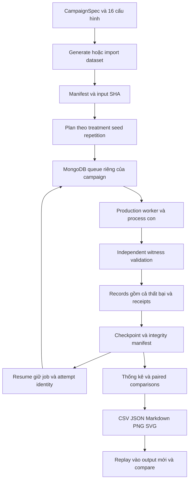

**Chú thích sơ đồ 15 — Một campaign nghiên cứu tạo ra bằng chứng gì?**

- Config xác định dataset, treatment, seed và repetition; plan triển khai các
  tổ hợp thành jobs. Manifest ghi xuất xứ/checksum để biết chính xác dữ liệu đã dùng.
- `Records` giữ cả thành công và thất bại. `Checkpoint` ghi tiến độ; nhánh
  Resume quay lại queue để tiếp tục phần chưa xong theo job/attempt identity.
- Analysis tổng hợp records thành thống kê/báo cáo. Replay chạy lại ở đích mới;
  compare đối chiếu kết quả, không thay thế các records ban đầu.

Checkpoint và attempt identity hỗ trợ resume mà không ghi đè kết quả. Runtime/
config drift bị từ chối. HTTP giới hạn một campaign supervisor hoạt động tại
một thời điểm; supervisor gọi cùng runner/worker, không dùng kết quả mô phỏng giả.
MongoDB namespace campaign được dẫn xuất từ logical output path và prefix.

### Cấu hình E01–E15 đã đối chiếu

`T` = `wall_s`, `M` = `peak_child_rss_bytes`, `D/Q` = mean distance/wait;
`J1/J2/J3` là stage objectives; `J` là joint objective. Cột cuối dẫn tới nguồn
có thể kiểm tra, không tuyên bố mọi cấu hình đã chạy đủ.

| Mã và câu hỏi | So sánh thực sự | Chỉ số | Cấu hình và nguồn kiểm tra |
|---|---|---|---|
| E01: local search cải thiện layout xây dựng? | Grid/local_search, dừng T1 | T, M, J1 | [main](experiments/configs/main.json), [pilot](experiments/configs/pilot.json); audit pilot |
| E02: greedy/MILP khác nhau trong budget bằng nhau? | Greedy/MILP, dừng T2 | T, J2 | [algorithm comparison](experiments/configs/algorithm_comparison.json); [failure controls](experiments/configs/failure_controls.json) giữ thất bại |
| E03: optimized facings tăng capacity vật lý? | First-fit/MILP, dataset facings, dừng T3 | T, J3 | [algorithm comparison](experiments/configs/algorithm_comparison.json); audit pilot |
| E04: routing ảnh hưởng travel? | nearest/return/exact, dataset fixed assignment | T, D/Q | [algorithm comparison](experiments/configs/algorithm_comparison.json); audit pilot |
| E05: đánh giá đủ candidates cải thiện score? | 1/4 candidates, layout optimizable | T, D/Q | [main](experiments/configs/main.json); audit pilot |
| E06: tải, picker và chiều cao ảnh hưởng thế nào? | 1 picker so với 3 picker **và** arrival 120, tiny/low_shelf | T, D/Q | [sensitivity](experiments/configs/sensitivity.json); là thay đổi kết hợp, không cô lập mọi tác động |
| E07: bỏ wait weighting thay đổi chọn nghiệm? | Wait weight 0/1, bốn candidates | T, D/Q | [ablation](experiments/configs/ablation.json); audit pilot |
| E08: resource tăng theo size? | Tiny/Small/Medium/Large, **dừng T1** | T, M | [scalability](experiments/configs/scalability.json); không phải benchmark toàn T1–T4 |
| E09: routes chịu perturbation nhu cầu/SKU? | Baseline/exact trên volatile và uneven | T, D/Q | [robustness](experiments/configs/robustness.json); không thuộc pilot audit |
| E10: worker lặp cùng seed cho scientific bytes giống nhau? | Seeds 11/23, repetitions 2 | T, D/Q và SHA khi compare | [reproducibility](experiments/configs/reproducibility.json); không chứng minh mọi OS/solver |
| E11: feedback tốt hơn sequential/multistart? | Ba mode trên two_shelves | J, evaluations, iteration, holdout, T, D/Q | [effectiveness](experiments/configs/joint_effectiveness.json); cấu hình và test joint |
| E12: layer nào tạo cải thiện hợp lệ? | Sequential; T1-only/T2-only/T3-only/combined | Bộ chỉ số joint | [joint ablation](experiments/configs/joint_ablation.json); không giả định mọi layer đều có lợi |
| E13: finite search vượt plateau và chứng nhận được? | Năm mode ở local_trap; exact/hybrid 128 states | Bộ chỉ số joint và certificate | [certification](experiments/configs/joint_certification.json), [128](experiments/configs/joint_certification_128.json), [failure controls](experiments/configs/joint_failure_controls.json); audit joint |
| E14: quyết định/resource tăng trong budget giới hạn? | Sequential/feedback trên local_trap, two_shelves, Small | Bộ chỉ số joint | [joint scalability](experiments/configs/joint_scalability.json); không có Large joint |
| E15: nghiệm training còn tốt trên holdout rời? | Sequential/feedback; offsets 10001/20003 | Training/holdout J và resource | [holdout](experiments/configs/joint_holdout.json); khả năng tổng quát chỉ trên synthetic scenarios |

Đã đọc đủ 16 JSON configs. Có 15 mã thực nghiệm vì mỗi mã có thể xuất hiện trong
nhiều thiết kế. Config `pilot.json` bản gốc có một seed; audit ngày 22/10 dùng
thiết kế hai seed 11/23, ghi nhận 38 pilot jobs/replay và 10 E13 jobs/replay.
Không đồng nhất file config gốc với config snapshot của campaign đã chạy.
Audit xác minh cả 16 config theo schema, chưa chạy đầy đủ ma trận E01–E15.

Analysis giữ failure rates trên mọi attempted jobs; solution KPI chỉ có khi có
kết quả hợp lệ. Có mean/median/SD, khoảng tin cậy t và Wilson cho completion.
So sánh ghép cặp gộp repetitions cùng seed trước; t-test/effect size chỉ khi có
ít nhất ba seed và chênh lệch không suy biến, sau đó điều chỉnh Holm. Đây là
thống kê khám phá, chưa phải suy luận hiệu quả trên quần thể cửa hàng.

<a id="phan-17"></a>

## XVII. Cài đặt và khởi động trên Windows

Yêu cầu: PowerShell, Python 3.12, Node.js ≥22.12.0/npm và MongoDB. Dùng đường
dẫn root ngắn khi có thể. Không chạy setup trên virtual environment dùng chung:
script quản lý dependency của riêng dự án và loại các package persistence không dùng.

### Máy mới dùng MongoDB portable của dự án

```powershell
Set-Location D:\Smart_Retail_Floor_Allocation
py -3.12 -m venv .venv
.venv/Scripts/python.exe -m pip install -r backend/requirements-lock.txt
.venv/Scripts/python.exe -m pip install -e backend --no-deps
powershell -ExecutionPolicy Bypass -File scripts/start_mongodb.ps1 -InstallPortable
powershell -ExecutionPolicy Bypass -File scripts/setup.ps1
powershell -ExecutionPolicy Bypass -File scripts/start.ps1
```

Helper tải bản Windows đã pin, xác minh SHA-256, bind loopback và tạo thông tin
xác thực ngẫu nhiên riêng tư. `setup.ps1` cài Python/npm dependencies và kiểm tra
MongoDB/indexes. `start.ps1` kiểm tra cổng, xác minh database, ghi PID/start time,
chạy API/worker/frontend nền và chờ health.

### Checkout đã thiết lập

```powershell
powershell -ExecutionPolicy Bypass -File scripts/start.ps1
Invoke-RestMethod http://127.0.0.1:8010/api/health
```

- Frontend: [http://127.0.0.1:5173](http://127.0.0.1:5173).
- Research: [http://127.0.0.1:5173/#research](http://127.0.0.1:5173/#research).
- FastAPI Docs: [http://127.0.0.1:8010/docs](http://127.0.0.1:8010/docs).

`/api/health` ping database và trả `worker_online`, runtime identity.
Database khỏe không có nghĩa worker online; cần kiểm tra cả hai.
Windows scripts không tự đọc `.env`; cấu hình qua process environment hoặc
private fallback `var/mongodb/private.json` khi không đặt `MONGODB_URI`.

```powershell
powershell -ExecutionPolicy Bypass -File scripts/stop.ps1
# Khi bảo trì cần dừng cả tiến trình database do helper sở hữu:
powershell -ExecutionPolicy Bypass -File scripts/stop.ps1 -StopMongoDB
```

Stop chỉ nhắm PID/start time đã ghi và process con do dịch vụ sở hữu, giữ dữ liệu.
Nếu chạy thủ công để phát triển, mở các terminal riêng từ root:

```powershell
.venv/Scripts/python.exe -m uvicorn smart_retail.api.main:app --host 127.0.0.1 --port 8010
.venv/Scripts/python.exe -m smart_retail.workers.runner
npm.cmd --prefix frontend run dev
```

Ba lệnh là ba process chạy dài, không chạy nối tiếp trong cùng terminal đang
chờ process trước. Vite proxy `/api` sang backend; xem `frontend/vite.config.ts`.

| Sự cố | Kiểm tra và xử lý |
|---|---|
| MongoDB không kết nối | Kiểm tra process, authentication và URI riêng tư; chạy module health; không xóa DB |
| API không hoạt động | Xem `var/logs/api.err.log`; kiểm tra 8010 và dependency |
| Worker offline | Xem `worker.err.log`, heartbeat và URI/database giống API |
| Port đã dùng | Xác định chủ sở hữu bằng `Get-NetTCPConnection`; dừng đúng dịch vụ theo kế hoạch |
| Thiếu dependency | Chạy setup trong `.venv` dự án; npm dùng lock với `npm ci` |
| Job timeout | Đọc receipt/error/stage; giảm bài toán hoặc tăng budget trong giới hạn hợp đồng |
| Snapshot checksum mismatch | Giữ artifact, so manifest/bản lưu; không tự sửa hash để chạy tiếp |
| Source drift | Dùng lại môi trường tương thích đã ghi hoặc tạo campaign mới; không đổi identity của run cũ |
| Windows long path | Dùng thư mục root/temp ngắn; kiểm tra normalization và chạy verifier đường dẫn dài |

`var/mongodb`, artifacts và campaign/checkpoint là dữ liệu bền vững. Không xóa
chúng như cách xử lý lỗi khởi động. Log có thể chứa thông tin vận hành riêng tư.

<a id="phan-18"></a>

## XVIII. Triển khai Docker Compose

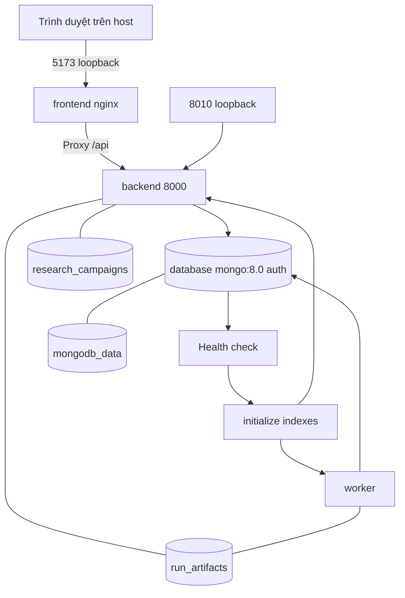

**Chú thích sơ đồ 16 — Đọc ranh giới container, cổng và nơi giữ dữ liệu.**

- Các hộp frontend/backend/worker/initialize là container hoặc bước khởi động.
  Mũi tên qua health → initialize biểu thị điều kiện sẵn sàng trước khi chạy dịch vụ.
- `5173 loopback` và `8010 loopback` là cổng trên máy host; `backend 8000` là
  cổng bên trong container. Frontend chuyển yêu cầu `/api` tới backend qua proxy.
- Các hình trụ dưới cùng là named volumes, không phải service bổ sung. Đường
  không mũi tên cho biết volume được gắn/chia sẻ; dữ liệu vẫn còn khi container dừng.

Database không publish cổng ra host; containers dùng network mặc định Compose.
Initialize chờ database healthy và phải hoàn tất trước backend/worker. Backend
image cài lock, package, datasets và experiment configs; frontend build bằng Node
rồi phục vụ static qua nginx. `run_artifacts` chia sẻ API/worker; backend sở hữu
volume research và khởi tạo research supervisor trong container của nó.

| Biến | Vai trò |
|---|---|
| `MONGODB_ROOT_USER`, `MONGODB_ROOT_PASSWORD` | Bootstrap authentication của database |
| `MONGODB_URI` | URI riêng tư dùng hostname `database`, đúng authSource |
| `MONGODB_DATABASE` | Mặc định `smart_retail` |
| `SMART_RETAIL_CAMPAIGN_DB_PREFIX` | Prefix namespace campaign, mặc định `sr_campaign_` |
| `SMART_RETAIL_API_PORT`, `SMART_RETAIL_WEB_PORT` | Cổng loopback host, mặc định 8010/5173 |

Tạo `.env` riêng tư từ [.env.example](.env.example), đặt credential thật bằng
secret manager hoặc editor cục bộ; không đưa URI/mật khẩu vào README, log hay Git.
Ví dụ URI loopback trong file mẫu phải được thay bằng URI container phù hợp khi
chạy Compose. Không dùng cùng data volume cho hai stack khác identity.

```powershell
docker compose --env-file .env config --quiet
docker compose --env-file .env up -d --build
docker compose --env-file .env ps
docker compose --env-file .env stop
```

Dùng `config --quiet` để không in cấu hình đã expand secrets. Dừng stack giữ
nguyên named volumes. Thay credentials môi trường không tự sửa tài khoản của
volume đã bootstrap trước đó. [Verifier Compose](scripts/verify_mongodb_compose.ps1)
tạo stack cô lập; không coi source Compose tồn tại là bằng chứng runtime thành công.

<a id="phan-19"></a>

## XIX. Tham chiếu API

Bảng đối chiếu trực tiếp `api/main.py` và `api/research.py`; `{id}` dưới đây là
placeholder cho `{identifier}` trong router. API chưa có authentication/authorization
đa người dùng. Error validation trả 422; mất kết nối database tại HTTP handler
trả 503 `DATABASE_UNAVAILABLE`, không đưa URI vào response. Startup database
không sẵn sàng có thể làm lifespan thất bại trước khi API phục vụ.

| Method | Endpoint | Chức năng | Đầu vào → đầu ra | Lỗi thường gặp |
|---|---|---|---|---|
| GET | `/api/health` | DB và worker health | → status/runtime | 503 |
| GET | `/api/schemas` | Schema bảy nhóm | → JSON Schema map | — |
| GET | `/api/projects` | Danh sách project | → Project[] | 503 |
| POST | `/api/projects` | Tạo project | `{name}` → Project, 201 | 422 |
| GET | `/api/projects/{id}` | Đọc aggregate | → Project | 404 |
| PUT | `/api/projects/{id}/inputs/{section}` | Lưu section CAS | JSON + `expected_revision` → Project | 404/409/413/422 |
| GET | `/api/projects/{id}/inputs/{section}/export` | Xuất input | `format=json/csv` → dữ liệu | 404/422 |
| POST | `/api/projects/{id}/inputs/{section}/import-csv` | Nhập bảng | `{text, expected_revision}` → Project | 409/422 |
| POST | `/api/projects/{id}/validate` | Kiểm tra đủ nhóm/tham chiếu | → valid/missing/errors | 404 |
| POST | `/api/projects/{id}/runs` | Enqueue snapshot | → Run, 202 | 404/422 |
| GET | `/api/projects/{id}/runs` | Lịch sử run project | → tối đa 100 runs | 404 |
| GET | `/api/runs/{id}` | Chi tiết có snapshot | → Run | 404 |
| POST | `/api/runs/{id}/cancel` | Hủy queue/running | → Run | 404 |
| POST | `/api/runs/{id}/replay` | Enqueue snapshot gốc | → Run mới, 202 | 404/409 source drift |
| GET | `/api/runs/{id}/report` | Export kiểm tra SHA | `format=json/csv` → attachment | 404/409/422 |
| GET | `/api/research/datasets` | Catalog generator | → metadata scales | — |
| GET | `/api/research/configurations` | Cấu hình có trên đĩa | → config list | — |
| GET | `/api/research/campaigns` | Campaign list | → checkpoint/supervisor | — |
| POST | `/api/research/campaigns` | Bắt đầu campaign | CampaignSpec → ID/status, 202 | 409/422 |
| GET | `/api/research/campaigns/{id}` | Chi tiết | → config/records/manifest | 404 |
| GET | `/api/research/campaigns/{id}/jobs/{job_key}/joint` | Joint evidence | → trace/bounds/decisions | 404/409 |
| POST | `/api/research/campaigns/{id}/cancel` | Yêu cầu hủy | → request status, 202 | 404 |
| POST | `/api/research/campaigns/{id}/resume` | Tiếp tục campaign | → supervisor mới, 202 | 404/409 |
| POST | `/api/research/campaigns/{id}/replay` | Campaign mới cùng config | → ID/status, 202 | 404/409 |
| GET | `/api/research/campaigns/{id}/report/{relative}` | Tải file đã confined | → JSON/CSV/PNG/SVG/MD | 404/409 |

Không có endpoint xóa project, pagination cursor hoàn chỉnh, solver HTTP đồng bộ
hay API triển khai dự kiến ngoài bảng. Resume HTTP chỉ nhận campaign paused/failed
theo chính sách service. Report path không được thoát report root.

Ví dụ PowerShell dùng fixture có thật, lưu theo revision tăng dần:

```powershell
$apiRoot = 'http://127.0.0.1:8010/api'
$projectBody = @{ name = 'Thực nghiệm tổng hợp' } | ConvertTo-Json
$project = Invoke-RestMethod "$apiRoot/projects" -Method Post -ContentType 'application/json' -Body ([Text.Encoding]::UTF8.GetBytes($projectBody))
$bundle = Get-Content datasets/samples/small_store.json -Raw -Encoding UTF8 | ConvertFrom-Json
foreach ($sectionName in @('floorplan','shelves','categories','products','demand','orders','optimization')) {
    $sectionBody = $bundle.$sectionName | ConvertTo-Json -Depth 100
    $saveUrl = "$apiRoot/projects/$($project.id)/inputs/$($sectionName)?expected_revision=$($project.revision)"
    $project = Invoke-RestMethod $saveUrl -Method Put -ContentType 'application/json' -Body ([Text.Encoding]::UTF8.GetBytes($sectionBody))
}
Invoke-RestMethod "$apiRoot/projects/$($project.id)/validate" -Method Post
$run = Invoke-RestMethod "$apiRoot/projects/$($project.id)/runs" -Method Post
Invoke-RestMethod "$apiRoot/runs/$($run.id)"
```

Các lệnh tạo dữ liệu và job thật; dùng project mới cho mỗi thử nghiệm. API 202
chỉ xác nhận enqueue, cần poll terminal status để biết kết quả.

<a id="phan-20"></a>

## XX. Kiểm thử và đảm bảo chất lượng

| Lớp kiểm tra | Công cụ và lệnh từ root | Phạm vi |
|---|---|---|
| Backend | `.venv/Scripts/python.exe -m pytest backend/tests --basetemp var/my-new-pytest` | Contracts/unit/integration/regression/performance |
| Unit numerical | `.venv/Scripts/python.exe -m pytest backend/tests/unit -q --basetemp var/my-new-unit` | Solver oracle, physical replay, proof attacks |
| Lint Python | `.venv/Scripts/python.exe -m ruff check --config backend/pyproject.toml backend/src backend/tests` | Theo rule của backend |
| Kiểu Python | `.venv/Scripts/python.exe -m mypy --config-file backend/pyproject.toml backend/src/smart_retail` | Source typing; cache ghi bị tắt |
| Dependency Python | `.venv/Scripts/python.exe -m pip check` | Tính nhất quán package |
| Kiến trúc | `.venv/Scripts/python.exe scripts/verify_architecture.py --output var/my-new-architecture.json` | Local import graph và ranh giới |
| Frontend | `npm.cmd --prefix frontend run lint` và `npm.cmd --prefix frontend run test` | ESLint, Vitest |
| Build | `npm.cmd --prefix frontend run build` | TypeScript và Vite |
| Dependency frontend | `npm.cmd --prefix frontend audit` | Audit dependency theo registry tại lúc chạy |
| E2E cô lập | `powershell -ExecutionPolicy Bypass -File scripts/verify_e2e.ps1` | API/worker/frontend thật, DB test riêng |
| Đường dẫn dài | `powershell -ExecutionPolicy Bypass -File scripts/verify_windows_long_path.ps1` | Unicode/deep paths, concurrency, HTTP repeats |
| Compose | `powershell -ExecutionPolicy Bypass -File scripts/verify_mongodb_compose.ps1` | Stack thực cô lập |
| Collector | `.venv/Scripts/python.exe scripts/verify_experiment_release.py --output var/my-new-release-check` | Các checks tuần tự và log/exit receipts |

Chọn output/temp chưa tồn tại để không thay bằng chứng cũ. MongoDB integration
cần server thật và quyền tạo database test; nếu fixture skip vì không có runtime,
không được diễn giải là persistence PASS. Playwright trực tiếp cần browser và
test services; script E2E chuẩn bị môi trường cô lập theo cấu hình của nó.

Các kiểm tra có ý nghĩa gồm concurrent CAS/claims, cancellation race, expired
owner, GridFS large integers, native BSON restore, corrupted cache, dependency
invalidation, source drift, route/time replay, deterministic results, Hypothesis
vật lý và oracle hữu hạn độc lập. Performance tests là probes giới hạn, không
thay capacity/endurance study. Chưa đo coverage percentage.

Kết quả audit lịch sử 22/10: 178 backend tests mỗi suite long/short; 4 Vitest;
10 Playwright; 24 gates PASS trong acceptance xác định. Warning đã ghi nhận:
Starlette TestClient/httpx deprecation. Không tái sử dụng các con số này để xác
nhận thay đổi source hôm nay; kết quả mới được ghi trong HANDOFF.

<a id="phan-21"></a>

## XXI. Khả năng tái lập nghiên cứu

Snapshot bất biến, source/dependency/model identity, seed, configuration manifest
và input/result SHA liên kết mỗi nghiệm với điều kiện tính toán. Scientific JSON
loại `hit`/`telemetry`; timing/CPU/RSS vẫn ở receipts/stage artifacts nên không
làm hash kết quả thay đổi chỉ vì chạy chậm hơn. Hai hash giống không chứng minh
khả năng khái quát khoa học; chúng kiểm tra tái lập đúng phạm vi artifact.

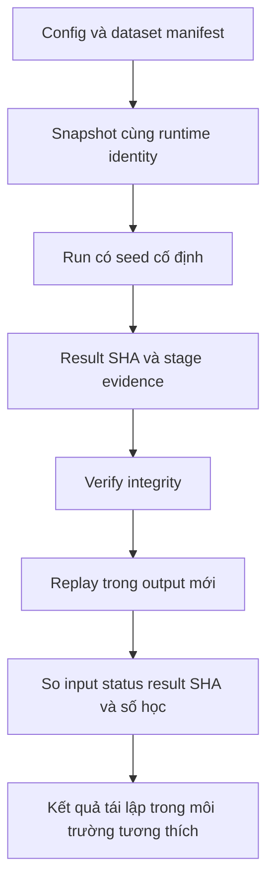

**Chú thích sơ đồ 17 — Tái lập cần cùng những điều kiện nào?**

- Đọc từ config/manifest đến snapshot/runtime để xác định đầu vào, source,
  dependency và seed của lần chạy gốc. Giữ seed đơn thuần chưa đủ để tái lập.
- `Verify integrity` kiểm tra tính toàn vẹn của tệp đã lưu. Replay mới là bước
  tính lại trong đích khác; compare kiểm tra hash, status và tương đương số học.
- Điểm cuối chỉ kết luận trong môi trường tương thích đã kiểm tra. Nó không
  chứng minh thuật toán hiệu quả trên dữ liệu thực hay tái lập trên mọi môi trường.

Ví dụ chuỗi CLI hiện hành, chạy từ root và dùng các đích mới:

```powershell
.venv/Scripts/python.exe -m smart_retail.application.experiments.cli run --config experiments/configs/pilot.json --output experiments/results/my-pilot --max-new-jobs 3
.venv/Scripts/python.exe -m smart_retail.application.experiments.cli resume --config experiments/configs/pilot.json --output experiments/results/my-pilot
.venv/Scripts/python.exe -m smart_retail.application.experiments.cli status experiments/results/my-pilot
.venv/Scripts/python.exe -m smart_retail.application.experiments.cli verify experiments/results/my-pilot
.venv/Scripts/python.exe -m smart_retail.application.experiments.cli analyze experiments/results/my-pilot --output experiments/reports/my-pilot
.venv/Scripts/python.exe -m smart_retail.application.experiments.cli replay experiments/results/my-pilot --output experiments/results/my-replay
.venv/Scripts/python.exe -m smart_retail.application.experiments.cli compare experiments/results/my-pilot experiments/results/my-replay --output experiments/reports/my-comparison.json
```

`verify` kiểm tra integrity, không tự chạy lại solver. `replay` chạy lại campaign;
`compare` báo `same_input_hash`, `same_status`, `byte_identical_result` và
`numerically_equivalent` với atol=$10^{-8}$, rtol=$10^{-9}$. Trường hợp thất bại
so error code, không dựng kết quả giả. So byte và so số học là hai kết luận riêng.

Xác minh certificate ngoại tuyến cần input và certificate thực được export:

```powershell
$runInputPath = Read-Host 'Đường dẫn input.json của run'
$certificatePath = Read-Host 'Đường dẫn certificate JSON đã xuất'
.venv/Scripts/python.exe -m smart_retail.application.feedback.cli --input $runInputPath --certificate $certificatePath --output var/my-new-proof.json --time-limit 120
```

Hai đường dẫn phải trỏ đến tệp thực đã lưu. Input phải còn joint config và
runtime tương thích; đây là lệnh
numerical offline rõ ràng, không phải endpoint chạy solver trong HTTP.

<a id="phan-22"></a>

## XXII. Giới hạn và hướng phát triển

| Nhóm | Nội dung | Cách diễn giải đúng |
|---|---|---|
| A — Đã triển khai, có kiểm chứng giới hạn | Queue/process, CAS/fencing, T1–T4 replay, finite proof, campaign/resume/report | Có bằng chứng trong phạm vi local synthetic và fixture xác định |
| B — Đã triển khai nhưng có giới hạn | Heuristic neighborhoods, grid navigation, finite exact, synthetic holdout, resource sampling | Chưa bảo đảm nghiệm tốt nhất tổng quát hay hiệu quả thực tế |
| C — Chưa triển khai hoặc chưa xác minh | Field data/calibration, đa người dùng/auth/RBAC, HA/failover, endurance, đầy đủ Large matrices | Là công việc tương lai, không phải tính năng hiện có |

| Hướng phát triển | Điều kiện cần trước khi nhận kết luận |
|---|---|
| Dữ liệu cửa hàng thực | Quyền sử dụng, đo lường có provenance và quy trình làm sạch |
| Hiệu chuẩn mô phỏng | Dữ liệu arrival/dwell/speed, đối chiếu trajectories và validation ngoài mẫu |
| Quy mô lớn | Thiết kế benchmark, nhiều independent instances/seeds, memory và wall receipts |
| Crowd dynamics | Mô hình tương tác hành lang và calibration riêng, không suy từ shelf queues |
| Multi-user deployment | Authentication, authorization, quota, audit/security review và tests |
| Độ bền vận hành | Crash/network/failover injection, backup drill và long-duration monitoring |
| Joint search mạnh hơn | Miền/mục tiêu rõ, validators và proof scope trước khi thay solver |

Chưa có category splitting, continuous global optimality, toàn bộ Pareto frontier,
empirical shopper calibration hay chứng minh expected objective trên mọi hành vi.
Holdout tổng hợp không thay validation tại cửa hàng. Không khẳng định nghiệm
MILP T2 hoặc T3 tối ưu đồng nghĩa toàn hệ thống tối ưu.

<a id="phan-23"></a>

## XXIII. Tài liệu tham khảo nội bộ

| Nội dung | Tài liệu |
|---|---|
| Quy tắc và bàn giao | [AGENTS](AGENTS.md), [HANDOFF](HANDOFF.md) |
| Kiến trúc hiện hành | [Current state](docs/architecture/CURRENT_STATE.md), [Dependency map](docs/architecture/DEPENDENCY_MAP.md) |
| Hợp đồng dữ liệu | [Input contracts](docs/data/input-contracts.md), [schema fixtures](datasets/schemas) |
| Mô hình joint | [Formulation](docs/research/JOINT_OPTIMIZATION_FORMULATION.md) |
| Sử dụng joint | [Hướng dẫn](docs/research/HOW_TO_RUN_JOINT_OPTIMIZATION.md) |
| Trạng thái nghiên cứu | [Research status](docs/research/RESEARCH_STATUS.md), [experiment validation](docs/system-audit/EXPERIMENT_VALIDATION.md) |
| MongoDB | [Operations](docs/migration/MONGODB_OPERATIONS.md), [Persistence checks](docs/migration/MONGODB_ONLY_ACCEPTANCE.md) |
| Sao lưu | [BSON/GridFS backup/restore](docs/migration/MONGODB_BACKUP_RESTORE.md) |
| Deployment | [Compose verification](docs/release/DEPLOYMENT_VERIFICATION.md) |
| Audit hệ thống | [Final audit](docs/system-audit/FINAL_SYSTEM_AUDIT.md), [Acceptance matrix](docs/system-audit/END_TO_END_ACCEPTANCE.md) |
| Hồ sơ nguyên bản | [Định vị bản lưu ngoài dự án](docs/architecture/HISTORICAL_ARCHIVE.md) |

Tài liệu hiện hành mô tả triển khai MongoDB. Các báo cáo nguyên bản đã lưu bên
ngoài không được biên tập thành kết quả kiểm chứng mới; bản tóm lược còn lại
phải được đọc cùng ngày, source identity và giới hạn của chính lần chạy đó.

<a id="phan-24"></a>
