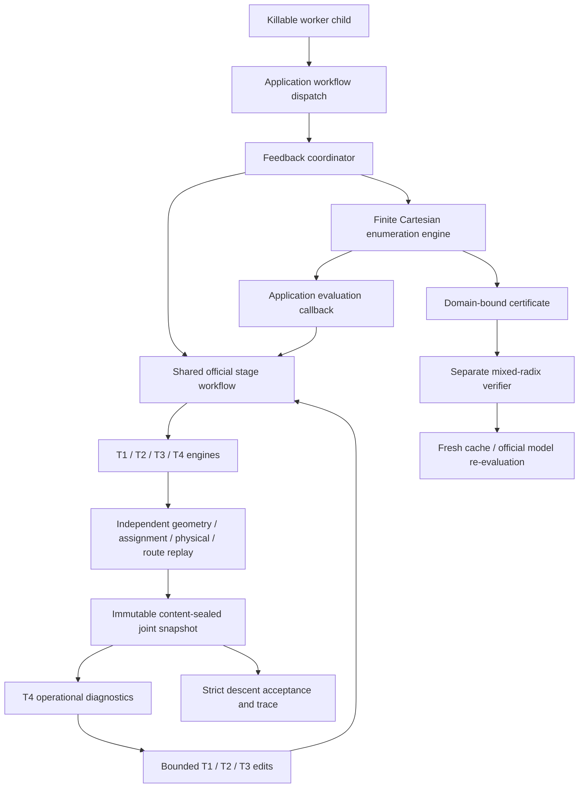
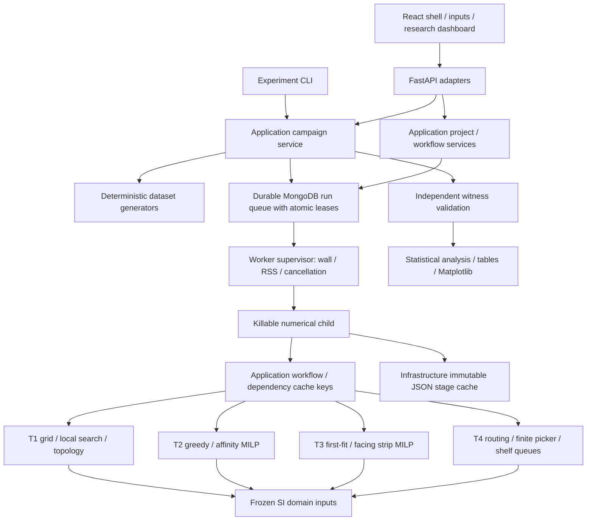

# Dependency map - current research platform

Primary database: MongoDB/PyMongo. Project/run/worker structural contracts are in
`infrastructure/repositories/contracts.py`; concrete repositories, serializers,
GridFS, indexes and client ownership are in `infrastructure/mongodb/`. API and
campaign adapters share the same native durable queue. The offline SQLite importer
is an explicit migration CLI only. Domain and engines import no PyMongo/GridFS.
See [migration acceptance](../migration/MONGODB_MIGRATION_ACCEPTANCE.md).

## Joint extension

Numerical engines import no API, ORM, application or infrastructure. The exact
engine receives an application-owned evaluator callback rather than choosing the
end-to-end workflow. `application/stage_workflow.py` contains shared T1-T4 and
decision replay; `application/workflow.py` handles mode dispatch and the original
bounded multistart path. StageCache remains an infrastructure implementation passed
through the application. Every evaluated joint state and event is written through
the worker observer before proceeding. Runtime/cache-hit telemetry is retained in
stage artifacts outside scientific result identities.

See [joint model scope](../research/JOINT_OPTIMIZATION_FORMULATION.md) and
[JO acceptance](../research/JOINT_OPTIMIZATION_ACCEPTANCE.md).

## Platform dependencies

Contracts are Pydantic adapters; domain/engines do not import HTTP/ORM/application.
Shared navigation is an engine utility depending on geometry/domain only. Source
identity includes backend Python source, complete installed dependency versions,
HiGHS version and explicit model versions. Every queue job binds that identity.

Stage invalidation keys:

| Stage | Direct dependencies |
|---|---|
| T1 | Floorplan, shelf definitions/poses/mode, variant, layout algorithm/iteration budget |
| T2 | Placed shelves, categories including affinity, floor/entrance, T2 algorithm/weights |
| T3 | Placed shelves, products/facing ranges/compatibility, assignment, T3 algorithm |
| T4 | Placed shelves, planogram, assignment, floor/connectors, demand/picker/policy, orders/products, seed |

Every stage additionally binds source/dependency/model identity and job wall
budget. Time-limited MILP incumbents are not published as reusable cache entries.
Changing only product data reuses independent T1/T2, recomputes T3/T4. A queue
rerun with changed inputs is therefore a partial recomputation by dependency,
while each run still owns a complete immutable snapshot and stage evidence.

Execution order: contracts -> independently verified engines -> integrated/cache
workflow -> generator -> campaign runner -> analysis/report -> dashboard -> pilot
-> controlled main campaign -> replay/clean-environment verification -> readiness.

Run scripts/verify_architecture.py for the executable local import graph audit.
Static graph validation does not claim browser rendering or external-library
cycle analysis; those have separate test evidence.
