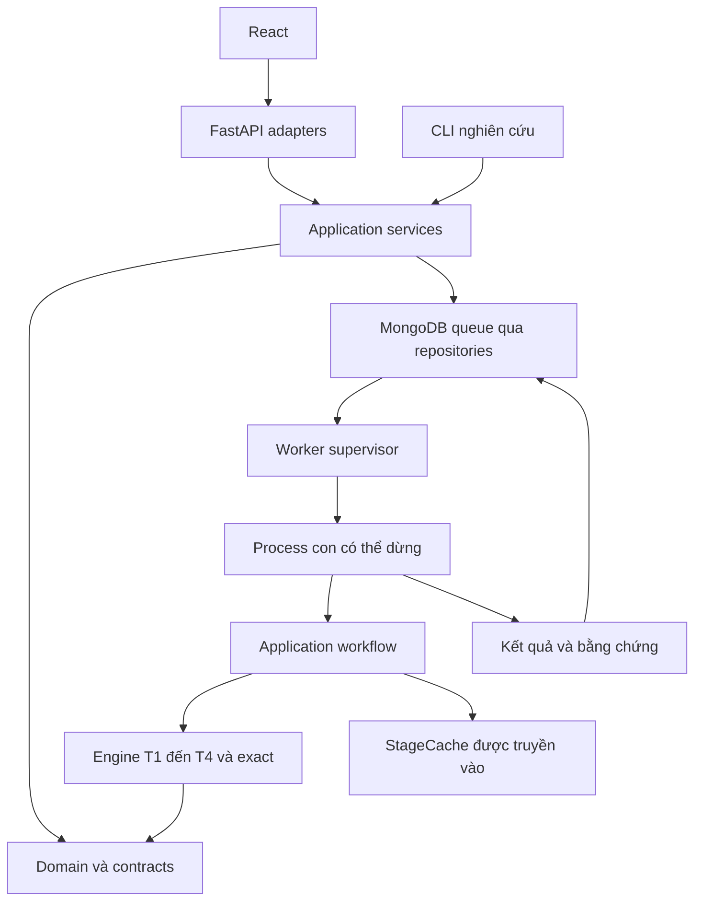

# Ranh giới phụ thuộc hiện hành

HTTP adapters và CLI dùng application services. Engines không import HTTP,
application hay database; exact nhận callback đánh giá do application cung cấp.
Persistence nằm tại `infrastructure/mongodb/`; hợp đồng repository nằm tại
`infrastructure/repositories/contracts.py`.

| Tầng cache | Phụ thuộc chính |
|---|---|
| T1 | Floorplan, shelves, variant, thuật toán, iteration budget |
| T2 | Kệ đã đặt, categories, floorplan, thuật toán và trọng số |
| T3 | Kệ, products, assignment, thuật toán slotting |
| T4 | Kệ, planogram, assignment, floorplan, demand, orders, products, seed, routing |

Khóa còn ràng buộc runtime identity, model version, budget và joint context.
Incumbent hết thời gian không được lưu như kết quả cache hoàn chỉnh.
Kiểm tra import bằng `scripts/verify_architecture.py`.
