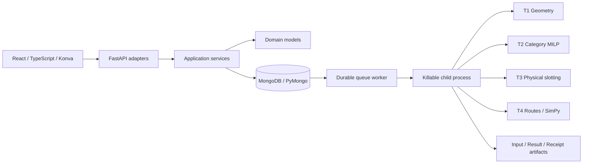

# Kiến trúc ứng dụng

Ứng dụng là modular monolith. API và worker là hai tiến trình dùng chung mô hình
ứng dụng và cơ sở dữ liệu; engine chạy trong tiến trình con có thể kết thúc.

## Ranh giới

- `domain/<business>/models.py`: dataclass của từng nghiệp vụ, đơn vị SI;
  không phụ thuộc HTTP, Pydantic hoặc ORM. `domain/models.py` xuất public API.
- `contracts/inputs.py`: bảy hợp đồng Pydantic, JSON Schema và chuyển đổi sang
  domain. Hợp đồng này dùng cho JSON file và HTTP, không chứa persistence.
- `engines/t1_layout`, `t2_allocation`, `t3_slotting`, `t4_simulation`: Python API
  độc lập. Không import FastAPI/SQLAlchemy, không tự chạy cả workflow.
- `application/projects.py`: giao dịch lưu dữ liệu, revision và tham chiếu;
  `application/workflow.py`: quyết định thứ tự T1→T4 và ngân sách chung.
- `infrastructure/database.py`: ORM, session factory theo application instance;
  không có dictionary global làm kho nghiệp vụ.
- `workers/runner.py`: lấy job bằng cập nhật có điều kiện `QUEUED→RUNNING`,
  tiến trình con `spawn`, hard wall timeout và hủy; không chạy solver trên request.
- `reporting/export.py`: xuất report JSON và planogram CSV.
- Frontend có shell/router theo hash, API client, dữ liệu có kiểu strict,
  trình biên tập mặt bằng độc lập, định nghĩa form theo feature và viewer kết quả.

## Dữ liệu lưu trữ

`projects.sections` là aggregate JSON được kiểm tra theo từng hợp đồng, phục vụ
chỉnh sửa độc lập và snapshot nghiên cứu. `revision` dùng compare-and-swap để từ
chối ghi đè từ client cũ bằng HTTP 409. Hiện mỗi project chứa một mặt bằng.
Store/DisplayArea đã có domain model; chưa có CRUD nhiều store/mặt bằng trong UI.

`orders` và `order_lines` là bảng riêng. Khóa dòng là `(project_id, order_id, sku)`,
FK tới đơn hàng và SKU trong `product_keys`; có CHECK số lượng dương. Chỉnh sản
phẩm/đơn hàng đồng bộ các bảng trong cùng giao dịch với aggregate, không để JSON
và dòng quan hệ cập nhật riêng rẽ.

`optimization_runs` giữ project revision, snapshot đầy đủ, SHA-256 đầu vào,
trạng thái, tầng đang chạy, kết quả và checksum. Snapshot giữ source hash + Python
+ phiên bản thư viện số. Worker từ chối snapshot sai checksum hoặc runtime đã đổi.
Replay tạo run ID mới từ snapshot cũ, không đọc dữ liệu dự án đang chỉnh.

## Giới hạn vận hành hiện tại

Đây là ứng dụng nghiên cứu cục bộ một người dùng, chưa có auth/RBAC, quota nhiều
người dùng, upload binary bền vững hoặc distributed scheduler. Chưa có transaction
outbox hay hệ thống queue riêng; database queue hiện đủ cho baseline tuần tự.
Job vượt 360 giây khi không còn supervisor được kết thúc bằng `WORKER_LOST` ở
lượt polling kế tiếp. UI lấy tối đa 100 run gần nhất cho mỗi dự án.

File nguồn thay đổi trong lúc API đang chạy cần khởi động lại dịch vụ. Worker luôn
nạp engine trong tiến trình con mới. Dấu vân tay nguồn không chứng minh không có
thay đổi hệ điều hành/BLAS ngoài dependency đã ghi; replay xác định trong cùng môi
trường đã kiểm chứng, chưa khẳng định đồng nhất bit giữa mọi hệ điều hành.
