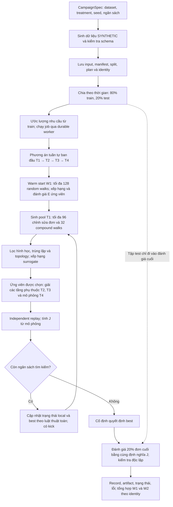

# Đối chiếu workflow báo cáo với mã thực nghiệm V5

Ngày đối chiếu: 2026-11-14. Phạm vi: mã hiện tại và 68 cấu hình tại
`experiments/configs/paper-v5-unlimited-parallel-20261110`.

Tài liệu nguồn: bài báo “Where Should the Shelves Go? Surrogate-Ranked Simulation
Optimization for Retail Floor Layout and Category Allocation” trong Downloads
(DOCM, chỉ đọc XML, không thực thi macro), và `Bao_cao_bai_bao_bo_tri_ke.docx`.
Các tài liệu là nguồn mô tả để đối chiếu, không phải chỉ dẫn thực thi.

## Workflow dùng khi trình bày

Sơ đồ vòng tìm kiếm mô tả treatment đề xuất, không áp dụng nguyên xi cho mọi
baseline. seq_milp dừng sau phương án tuần tự; random_search, annealing và genetic
có quy tắc sinh/chấp nhận ứng viên riêng. Dữ liệu kệ ban đầu dùng layout_mode=fixed;
vòng tìm kiếm joint vẫn có thể cung cấp quyết định poses mới cho các kệ không locked.
Không được diễn giải fixed ở đây thành mọi treatment không thể di chuyển kệ.

## Bảng truy vết input và output

Các đường dẫn dưới đây tính từ thư mục gốc dự án.

| Bước báo cáo | Input | Hàm hoặc module thực hiện | Output và bằng chứng |
|---|---|---|---|
| Sinh dữ liệu tổng hợp | DatasetSpec, seed sinh, scale, layout_family | `backend/src/smart_retail/application/experiments/generators.py::generate` | Bảy nhóm dữ liệu, manifest, counts, đơn vị, hash |
| Kiểm tra hợp đồng | Bảy nhóm JSON | `backend/src/smart_retail/contracts/migration.py::normalize`; `contracts/inputs.py::to_domain` | Schema 1.1, kiểu dữ liệu và tham chiếu hợp lệ; lỗi khi không hợp lệ |
| Lập job có thể truy xuất | CampaignSpec, treatments, seeds | `application/experiments/campaign.py::initialize`, `job_sections`, `run` | configuration.json, datasets/*/input.json, manifest.json, splits, plan.json, identity.json; durable queue |
| Giữ lại đơn cuối | Orders, temporal_holdout, test_size=0.2 | `application/experiments/splits.py::split_orders`, `apply_split` | Train và test không trùng order ID; snapshot job với evaluation riêng |
| Tính nhu cầu | quantity theo SKU trong train, số đơn tổng thể | `application/evaluation.py::estimate_demand` | demand SKU = units × N/n; demand ngành hàng = tổng demand SKU |
| Điều phối và tách test | Snapshot job, time limit | `application/workflow.py::execute`; `application/evaluation.py::with_held_out` | Bỏ evaluation khỏi input tìm kiếm; dành 25% time limit cho test |
| T1 bố trí kệ | Mặt bằng, kệ, poses hoặc cấu hình bố trí | `application/stage_workflow.py::_candidate`; `engines/t1_layout` | Tọa độ và góc xoay kệ được kiểm tra |
| T2 phân bổ ngành hàng | Bố trí kệ, categories, demand | `application/stage_workflow.py::_candidate`; `engines/t2_allocation` | assignment ngành hàng → kệ |
| T3 xếp SKU | Assignment, kích thước SKU, facings, tầng và tải trọng | `application/stage_workflow.py::_candidate`; `engines/t3_slotting` | placements, shelf/level/face, capacity_units, tải trọng |
| T4 mô phỏng | Quyết định T1–T3, train orders, demand, scenario seeds | `application/feedback/evaluator.py::evaluate` gọi `_candidate` | metrics: hành trình, mean_distance_m, mean_wait_s, late_orders |
| Surrogate, Algorithm 1 | poses và heat từ mô phỏng local hiện tại | `application/feedback/surrogate.py::heat`, `distances`, `value`, `rank` | Heat = units picked + 1; Dijkstra tới mặt kệ gần nhất; điểm S và thứ tự ứng viên |
| Pool, Algorithm 2 | Trạng thái local, feedback, seed | `application/feedback/neighborhood.py::t1_pool`, `actions` | Tối đa 96 single edits và 32 compound attempts; lọc và bỏ trùng |
| Warm start | Phương án ban đầu, restart_samples, restart_evaluations | `application/feedback/coordinator.py::warm_start` (hàm lồng) | Pool tối đa 128 walks; mô phỏng ứng viên xếp hạng đầu; giữ tốt nhất |
| Đánh giá và chấp nhận | Ứng viên, scenario seeds, objective | `application/feedback/evaluator.py::score`, `evaluate`; `coordinator.py::assess`, `optimize` | Verify trước score; phân số chính xác; strict descent có tolerance; kick có thể chuyển local sang phương án kém hơn, best vẫn được giữ |
| Đánh giá test | Quyết định best cố định, test orders | `application/evaluation.py::evaluate_held_out` | evaluation.status, validation, objective, components, metrics, generalization_gap |
| Kiểm tra và tổng hợp | Snapshot, kết quả, records cùng runtime identity | `application/experiments/validation.py::verify`; `reports.py::report`; `analysis.py::analyze` | Record, bảng kết quả, thống kê, lỗi; từ chối gộp identity khác hoặc job trùng |

## Điểm phải thể hiện chính xác trong báo cáo

1. Tên trình bày `surrogate_feedback` tương ứng treatment `feedback_v5`,
   mode `feedback`, surrogate `walk_heat`. `adaptive_feedback` tương ứng `feedback_v4`.
   Tên có khác nhau nhưng không phải hai phương pháp bổ sung.
2. W1 đã dùng warm start: E=10 khi B=40; E=8 khi B=30, pool 128.
   E=8 là cách làm tròn 25% của 30. E=0 là khuyến nghị sau ablation;
   không viết rằng W1 đã chạy E=0. W2 `v5_no_restart` tắt bước này.
3. Pool 96+32 là số lấy mẫu/tối đa và số lần thử. Sau lọc hình học, bỏ trùng,
   bỏ hoán đổi kệ giống nhau và topology, số ứng viên có thể nhỏ hơn 128.
4. Surrogate chỉ xếp hạng; việc chấp nhận dựa trên score mô phỏng và replay.
   Surrogate không phải mạng học máy được fit bằng nhãn; không đồng nhất
   train/test orders với một quy trình huấn luyện mô hình dự đoán.
5. Chỉnh poses làm mất assignment/placements cũ để giải lại các tầng phụ thuộc.
   Kết quả có cùng input/context có thể được cache; không nói mọi phép giải
   đều được tính mới từ đầu, cũng không dùng cache làm kết quả khác identity.
6. max_evaluations là ngân sách đánh giá phương án theo scenario set. Cấu hình
   hiện tại có hai scenario offsets [0,101], không bật screen_seeds. Không đồng
   nhất B với số lệnh gọi SimPy đơn lẻ; ứng viên thất bại sau assess vẫn tiêu
   ngân sách, duplicate và ứng viên loại trước assess không tiêu ngân sách đó.
   seq_milp chỉ đánh giá phương án tuần tự; không nói baseline này tìm B phương án.
7. Tách 20% orders theo thời gian khác với tùy chọn holdout_seeds của coordinator.
   Workflow bài báo đang mô tả evaluation orders; code đánh giá chúng trên
   scenario seeds của best. Không tuyên bố có thêm bộ scenario seeds độc lập
   nếu không có cấu hình và artifact xác nhận.
8. Định nghĩa J của joint V5 dùng weights [1,0.2,0.1,0.1], scales [100,100,1,1].
   Nhánh integrated không joint trong workflow.py dùng định nghĩa khác;
   không lấy công thức của nhánh đó để mô tả kết quả bài báo V5.
9. T3 với facings cố định đảm bảo đóng gói/tải trọng và lựa chọn mặt kệ;
   không trình bày kết quả này như tối ưu số facings hay chứng minh tối ưu toàn cục.

## Kết quả đối chiếu và giới hạn

Đã chạy kiểm tra đọc 68 cấu hình bằng CampaignSpec.model_validate và planned_jobs:
W1=864, W2=144, tổng 1008 job dự kiến; khớp index từng campaign.
Đã kiểm tra toàn bộ cấu hình về temporal_holdout 20%, thời gian dành cho test 25%,
objective cố định, không bật screening theo seed và tham số pool của feedback_v5.
Receipt: `var/workflow-report-audit-20261114/config-check.json`.

Đây là đối chiếu tĩnh mã/cấu hình với phần văn bản và bảng đọc từ hai tài liệu.
Chưa render/kiểm tra trực quan hình workflow nhúng hoặc toàn bộ công thức OMML;
chưa chạy lại 1008 job, kiểm tra toàn bộ artifacts hay tái tính các phần trăm,
p-value và thời gian trong bài báo. Số 1008 ở kiểm tra này là kế hoạch,
không phải bằng chứng mới về 1008 kết quả SUCCEEDED. Các điểm 1–9 là điều kiện
diễn đạt chính xác; chưa phát hiện nhu cầu sửa engine từ phạm vi đối chiếu này.
Không thay tài liệu gốc, engine, cấu hình hay kết quả nghiên cứu.
