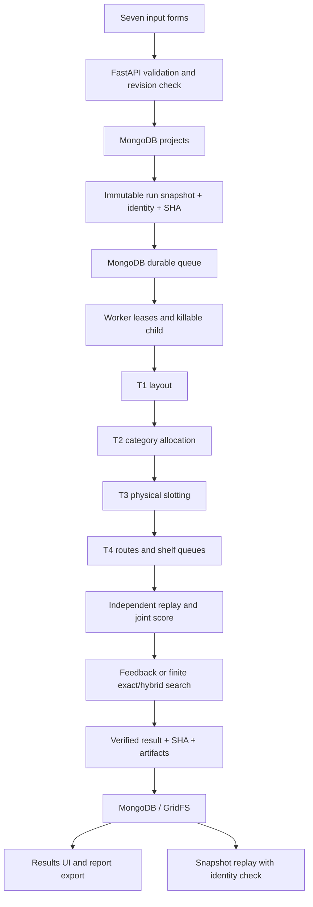

# Data flow and field consumption

> Bản tóm lược được biên tập ngày 23/10/2026. Kết quả dưới đây thuộc lần kiểm chứng ngày 22/10/2026, không phải lần chạy mới. Báo cáo nguyên bản và định vị bản lưu: [hồ sơ lưu trữ](../architecture/HISTORICAL_ARCHIVE.md).

Audit `20261022-afbb7971`, performed on 2026-10-22. All paths below are relative to the repository unless stated otherwise.

Evidence root: `var/system-audit/20261022-afbb7971/final/` (abbreviated **E/** below).
Source SHA-256: `321d73d95a4ba9952f4af622601a02edb04f2ad95e60e5c1ddb569408e8841dc`. Audit baseline Git HEAD: `081253604b329b4fba0a75bfe8c58755d47c3fd7`; original report retained in the external historical archive.

| Input group | Runtime consumer | Verification |
|---|---|---|
| floorplan | T1 geometry/navigation, T4 routing | Boundary, obstacles, entrances/exits, no-shelf/required-aisle zones; independent geometry/path replay |
| shelves | T1 poses; T2 category capacity; T3 dimensions, levels, faces and shared loads | Fixed shelf retained, placement/physical constraint replay |
| categories | T2 width, allocation, fixed/proximity/separation constraints | Independent enumeration and objective reconstruction |
| products | T3 dimensions/orientation/facings/stack/stock; T4 SKU service targets | Independent packing and stock enumeration; quantity-based picking time |
| demand | T4 seeded baskets, arrivals/periods, speed and service parameters | Manual route/time arithmetic and deterministic replay |
| orders | T4 parent orders, SKU lines, quantity, arrival and deadline | Referential checks and route/order/time replay |
| optimization | Stage methods, budgets, objective weights, candidate/feedback/exact controls | Queue snapshot identity, timeout/status tests, finite certificate verifier |

Seven API saves match direct MongoDB reads after every revision (E/full-regression/checks/seven-input-readback.json). Seven UI groups are saved, reloaded and read directly from MongoDB in E/e2e-final/browser/system-pages/verification.json. Four tabular CSV sections preserve metadata and nested cells in E/api-surface.json; non-tabular CSV is explicitly rejected with 422.

Dependency recomputation uses content identities, not timestamps. T1 changes invalidate T1/T2/T3/T4; T2 changes invalidate T2/T3/T4; T3 changes invalidate T3/T4. Routing changes alter the T4 key. Actual decision changes, before/after SHA, regenerated stages and replay validation are in E/numerical/feedback-action-T1.json, -T2.json, -T3.json and feedback-summary.json. Identical input reuse is separately checked; telemetry/cache hits are excluded from scientific result hashes.

Provenance fields (schema version, data origin/source metadata) are stored for traceability; they are not objective terms. Pickup points are validated as reachable points; this release does not implement a separate pickup-fulfillment routing workflow. Functional zone semantics are the declared no-shelf/required-aisle types, not a general merchandising policy language. These are disclosed model limits rather than evidence that every named field changes every objective.
